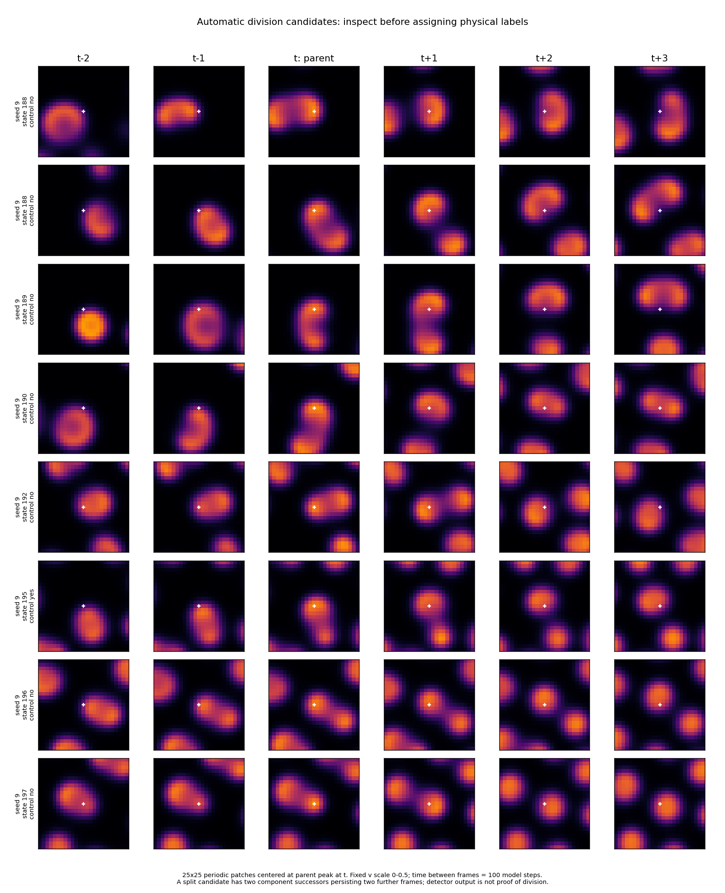
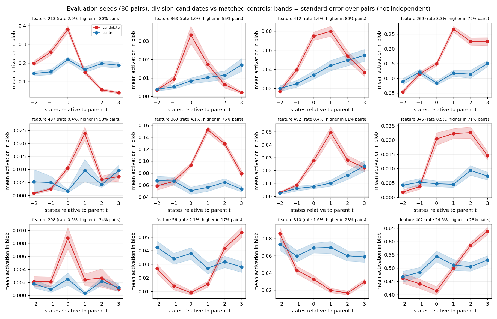
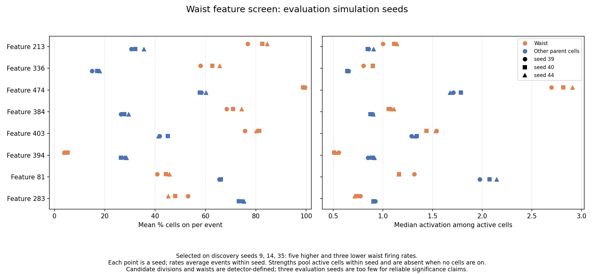
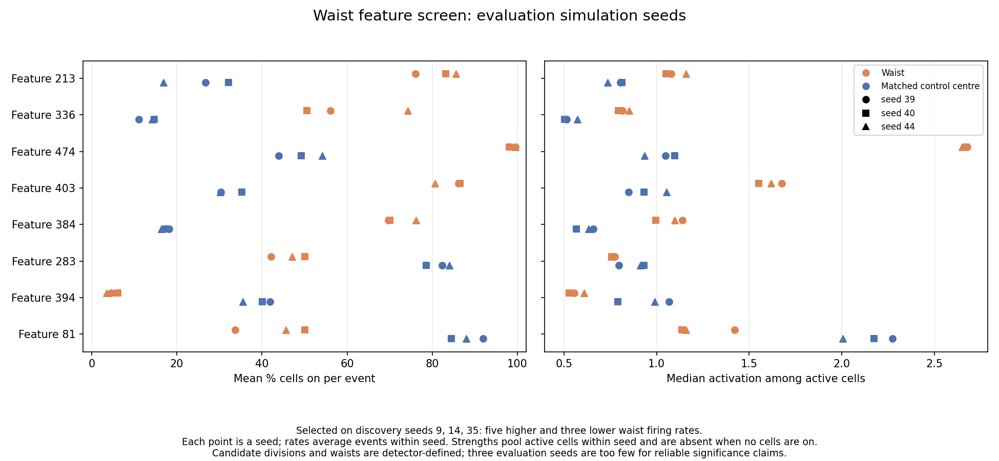

# Exploring blob division

[Back to the main README](README.md#54-blob-division-study)

We look for block-6 SAE features associated with **candidate blob divisions** in natural
Gray-Scott simulations. The simulator supplies the states; the emulator processes those
states and the SAE describes its internal activations. These are not free-running emulator
rollouts, and the measurements do not show that a feature causes division.

## What data do we use?

First generate the usual seed-0 dataset as in the
[main README](README.md#3-the-emulator). It supplies the Gray-Scott settings and
training-set normalization for the model. The division events **do not come from that
dataset's trajectory**.

Instead, each study script runs six new, natural Gray-Scott simulations, using the same
settings but initial-condition seeds 9, 14, 35, 39, 40 and 44. Each seed determines a
different arrangement of initial spots. Reusing the same seed and settings regenerates
the same trajectory; no divisions are injected. The simulations are recomputed by each
script rather than stored as large trajectory files.

For these settings, each run advances through 2,000 warm-up steps and a further
117,200 steps, then records 256 states 100 simulator steps apart. The additional advance
places these simulations at a comparable time to the validation window. The plots use
the supplied `model/emulator.pt` and `model/sae.pt`; retraining can change feature numbers.
Run the commands below from the repository root.

## 1. Find candidate divisions

For each simulated trajectory:

1. Threshold *v* at 0.2 and find periodic, four-connected components of at least four cells.
2. Link successive components if they overlap after a two-cell-radius dilation. A candidate
   parent at *t* must have an exclusive single-component history at *t−2* and *t−1*,
   exactly two exclusive successors at *t+1*, and two distinct exclusive successors at
   both *t+2* and *t+3*.
3. Suppress later candidates within six recorded states and seven grid cells of an earlier
   candidate. This approximate deduplication can remove distinct events or miss duplicates.

This operational detector is not proof that a physical blob divided. A changing
thresholded shape or nearby components can affect the result.

To simulate all six seeds, detect candidates and generate the example sheets:

```bash
python block6_division_study.py --data data/gray_scott.npz \
  --out results/division_candidates --discovery-seeds 9 14 35 \
  --evaluation-seeds 39 40 44 --states 250 --threshold 0.2 \
  --seed-selection "First six survival-screened seeds from 1 to 100; previously explored"
```

The script saves the events, their controls and settings in `summary.json`. The included
sheet is `candidates_seed_9_page_09.png`. This step does not use the emulator or SAE.



Each row shows a different candidate, centred on its parent's brightest cell at time *t*
(white +). Frames are 100 simulator steps apart. These eight examples are one page from
seed 9, not a random sample. The label `control yes/no` says whether an approximately
matched control was found; it does not mean the row itself is a control.

**What we see:** many candidates visually resemble separation into two spots, but their
shapes and surroundings vary. This sheet helps inspect the detector; it does not establish
how frequently true divisions occur or whether every detected event is one.

For the feature comparisons, we further require fewer than two significant peaks at *t−2*,
at least two at each of *t+1* through *t+3*, and greater peak separation at *t+3* than
at *t+1*. The peak test uses prominence 0.03. It can also accept zero peaks at *t−2*;
it is a filter, not independent validation. The regions used to find peaks can include
neighbouring components.

Controls are other same-state blobs matched approximately by area, elongation and peak
*v*, with no detected split during the next three states. Area ratios must be within 1.75,
elongation ratios within 1.5 and peak *v* within 0.1. Controls also have an exclusive
single-component history for two states and successor for three states. Matching is greedy
and controls are not reused in the same state. They may be elongated, almost split or split
later; matching is not exact.

The detector finds 93, 91 and 112 candidates in discovery seeds 9, 14 and 35 and 97, 93
and 95 in evaluation seeds 39, 40 and 44. The later peak and waist filters reduce these counts.

## 2. Features across whole blobs

This script regenerates the same six trajectories, filters the candidates using the peak
criteria above, rematches controls, and measures features from *t−2* to *t+3*:

```bash
python block6_clean_division_features.py --data data/gray_scott.npz --model-dir model \
  --out results/division_features --discovery-seeds 9 14 35 \
  --evaluation-seeds 39 40 44 --states 250 --threshold 0.2 --prominence 0.03 --threads 2
```

It saves the time-course figure and `summary.json` in `results/division_features`.



Features were ranked at *t* on seeds 9, 14 and 35 and plotted on seeds 39, 40 and 44:
**86 matched evaluation pairs**. Each curve averages the feature activation over the
blob region, including cells where the feature is off, and then over pairs. At each time
the region includes components touching a dilation of the parent region at *t*; this is
not exact tracking and can include neighbours. Red is the candidate and blue its control.
The title's percentage is the fraction of evaluation pairs with higher candidate mean at
*t*; the training firing rate is across SAE training cells, not these blobs. Shaded bands
are standard errors calculated over pairs, which are correlated, **not reliable confidence
intervals**.

**What stands out:**

- **213** rises before separation and peaks at *t*; its candidate mean is higher than
  its control in about 80% of pairs at that time. It is also active in controls.
- **412** rises around *t* and *t+1*; its candidate mean at *t* is higher in about 80%
  of pairs. **492** shows a later rise and is higher in about 81% of pairs at *t*.
- **369** is higher in about 76% of pairs at *t* and peaks at *t+1*. The waist analysis
  below shows why a whole-blob mean should not be mistaken for activity at the waist.
- **56 and 310** have lower candidate means than controls at *t* in most pairs. Conversely,
  feature **363** has a higher average in candidates but is higher in only 55% of pairs:
  the mean difference is not typical of every pair.

These are associations, not unique signatures of division. Different y-axis scales mean
heights should not be directly compared between panels.

## 3. What happens at the waist?

Whole-blob means can hide local behaviour. For peak-filtered candidates with exactly two
significant parent peaks at *t*, we approximate the waist as the lowest-*v* interior grid
cell on the straight periodic line between them, requiring the line to remain in the
parent component. The **waist region** is its 3×3 neighbourhood, clipped to that component.
The two comparisons are:

1. Waist versus all remaining parent-component cells: **135 evaluation events**.
2. Waist versus a 3×3 neighbourhood around the brightest cell of an approximately matched
   control, clipped to its component: **75 evaluation pairs**. Only candidates with
   controls are included, so the waist numbers need not match comparison 1.

After running the candidate detector in section 1, reproduce the waist scan with:

```bash
python block6_waist_scan.py --data data/gray_scott.npz --model-dir model \
  --source results/division_candidates/summary.json --out results/division_waist --threads 2
```

It regenerates the trajectories from the saved seeds and evaluates all 512 features.
It writes both figures and per-seed CSVs for all features; `events.csv` gives event
locations and region sizes. Unlike the time-course script, it uses controls matched
*before* peak filtering, so the pair counts differ.

Features were selected separately for each comparison by discovery-seed firing-rate
difference: five higher and three lower at the waist. Each plot shows evaluation seeds only.
Each marker shape identifies a seed. On the left, percentages are per-event fractions of
cells with activation > 0, averaged within that seed. On the right, the median is computed
over active cells pooled within that seed; off cells are excluded. It is not the fraction
of blobs that divide.



**Within the candidate:** 213, 336, 474, 384 and 403 fire in a larger fraction of waist
cells than of the rest of the parent in each evaluation seed. Feature **474** is especially
common at the waist (about 99% of cells per event on average), but it also fires elsewhere;
**213** shows a strong difference in both firing and median-on strength. In contrast,
**283, 394 and 81** fire less often at the waist. These observations identify regions with
different activity, not features exclusively dedicated to a waist.



**Against another blob:** 213, 336, 474, 403 and 384 again fire more often in waist
neighbourhoods than at control centres, while 283, 394 and 81 fire less often. Feature
**474** also has substantially greater median-on strength at the waist. This comparison
uses another blob, but a bright control centre is not a matched waist: differences could
reflect local shape or concentration, not division itself.

The table combines the features highlighted in either plot and feature 369, which we also
examined in the whole-blob study. Every entry is the **minimum–maximum across the three
evaluation seeds**, not an uncertainty interval. In each pair, the first number is the
waist and the second is the comparison region. Strength ranges exclude inactive cells.

| Feature | Waist / rest on (%) | Waist / rest median when on | Waist / control centre on (%) | Waist / control centre median when on |
|---|---|---|---|---|
| 213 | 76.7–84.5 / 30.5–35.4 | 1.00–1.14 / 0.85–0.91 | 76.1–85.6 / 16.9–32.1 | 1.05–1.16 / 0.74–0.81 |
| 336 | 57.9–65.7 / 15.0–17.9 | 0.80–0.90 / 0.64–0.65 | 50.6–74.3 / 11.1–14.7 | 0.79–0.85 / 0.50–0.57 |
| 474 | 98.7–99.5 / 57.8–60.1 | 2.69–2.91 / 1.67–1.78 | 98.0–99.6 / 43.9–54.2 | 2.65–2.68 / 0.93–1.10 |
| 384 | 68.4–74.4 / 26.4–29.4 | 1.06–1.11 / 0.87–0.90 | 69.7–76.1 / 16.4–18.2 | 1.00–1.14 / 0.57–0.66 |
| 403 | 75.7–81.3 / 41.3–45.0 | 1.44–1.54 / 1.29–1.34 | 80.7–86.5 / 30.2–35.3 | 1.55–1.68 / 0.85–1.05 |
| 283 | 45.1–53.0 / 73.2–75.3 | 0.72–0.77 / 0.90–0.92 | 42.2–50.1 / 78.6–84.0 | 0.76–0.77 / 0.80–0.93 |
| 394 | 3.9–5.2 / 26.4–28.5 | 0.51–0.56 / 0.85–0.91 | 3.6–6.2 / 35.6–41.9 | 0.53–0.61 / 0.79–1.07 |
| 81 | 40.8–45.7 / 65.4–66.1 | 1.16–1.32 / 1.98–2.14 | 33.7–50.1 / 84.5–91.9 | 1.14–1.42 / 2.01–2.27 |
| 369 | 0.0–0.6 / 14.1–16.0 | 0.39–0.51* / 0.68–0.74 | 0.0–0.4 / 10.7–13.6 | 0.39* / 0.44–0.76 |

*For feature 369, at least one seed has no active waist cells, so its conditional median
is undefined; the displayed range uses only seeds with active cells and is based on very
few observations.* This feature can have a higher whole-blob mean in division candidates
while rarely firing at the waist: these measure different regions.

The complete 512-feature per-seed results, including event and active-cell counts, are in
[per_seed_features.csv](figures/blob_division/per_seed_features.csv).

## Limitations

The six seeds are the first six of 12 survivors found when screening seeds 1–100 after
warm-up. They were explored previously; evaluation seeds are separate from discovery seeds
but are **not a fresh blind test**. Cells and events within a simulation are correlated.
Three evaluation simulations are too few for reliable multiple-testing-corrected
significance claims. The detector, threshold, peak and waist definitions influence which
events are included. Results need not generalise to other parameters or trajectories,
and matching does not isolate a causal division-specific signal.
