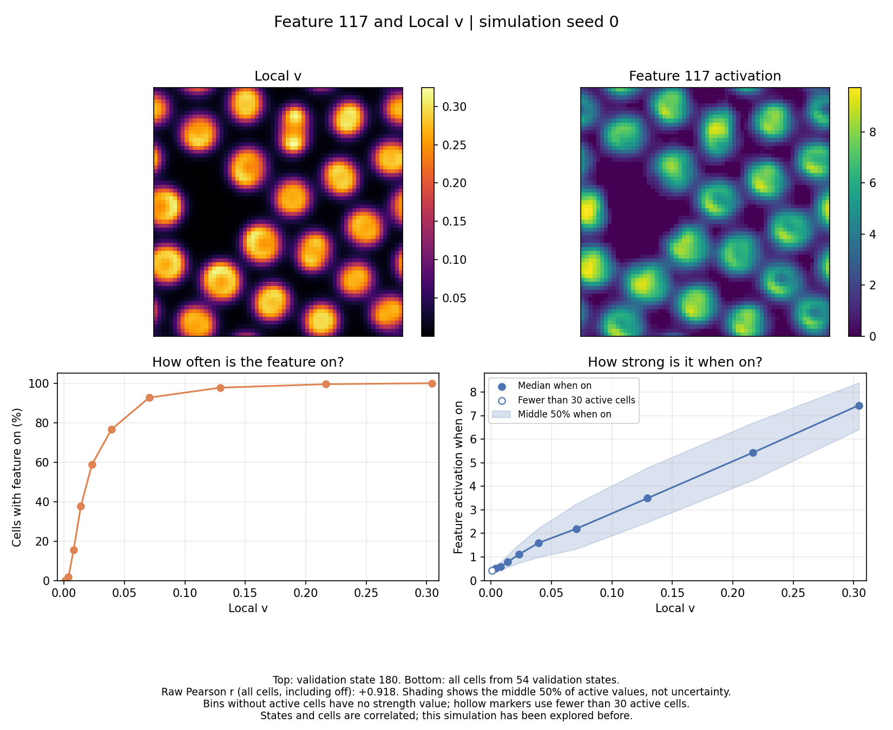
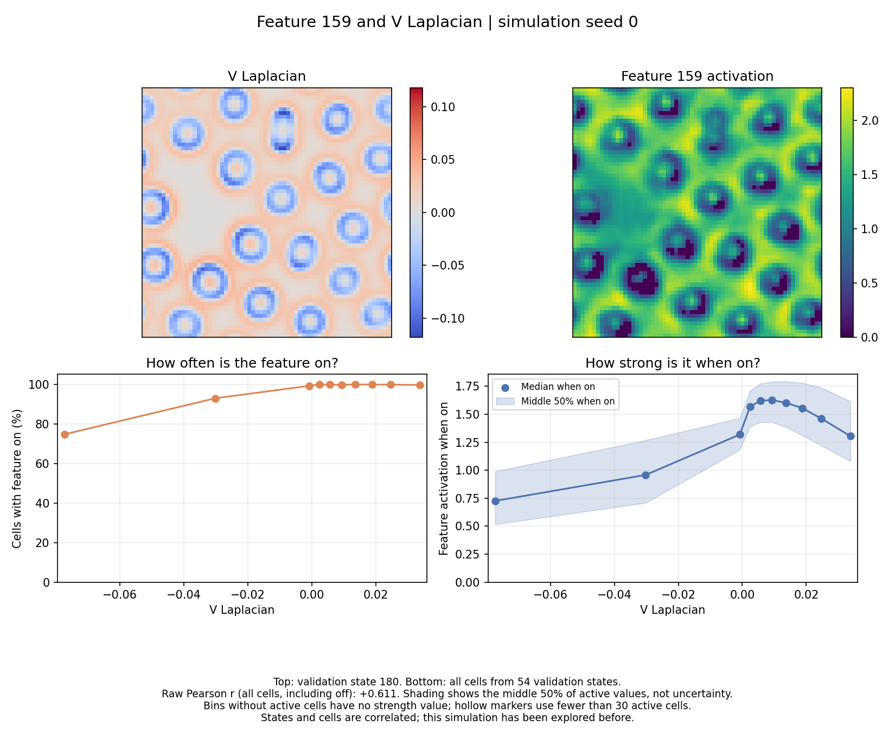
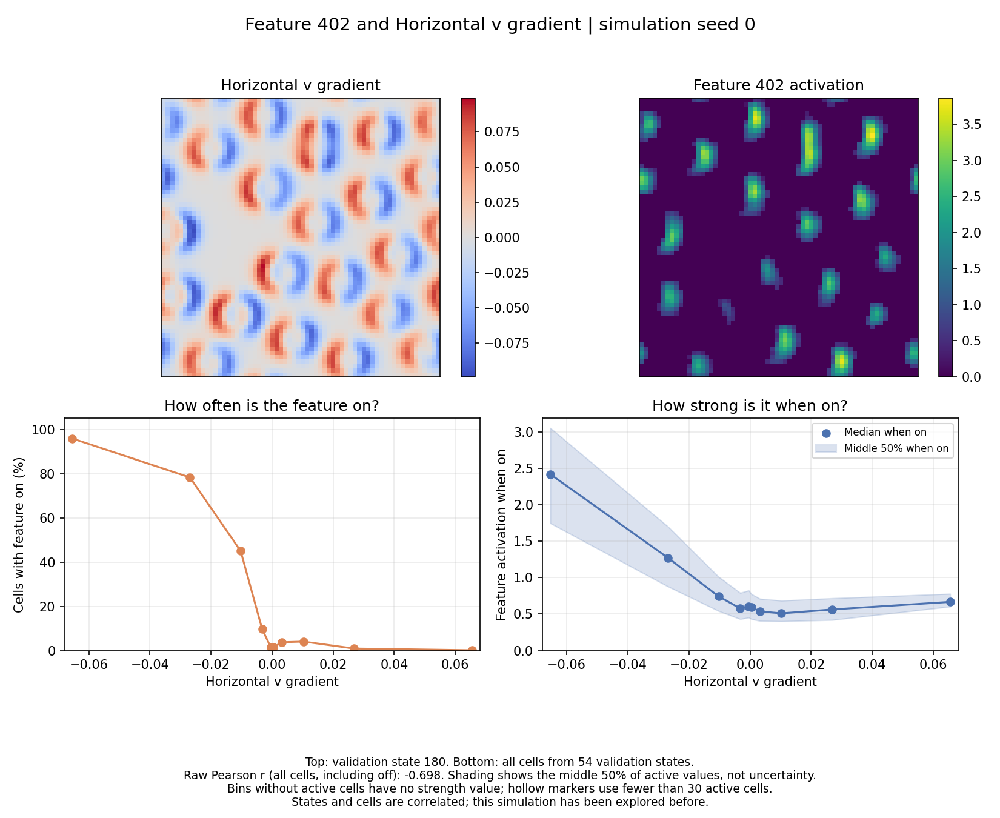
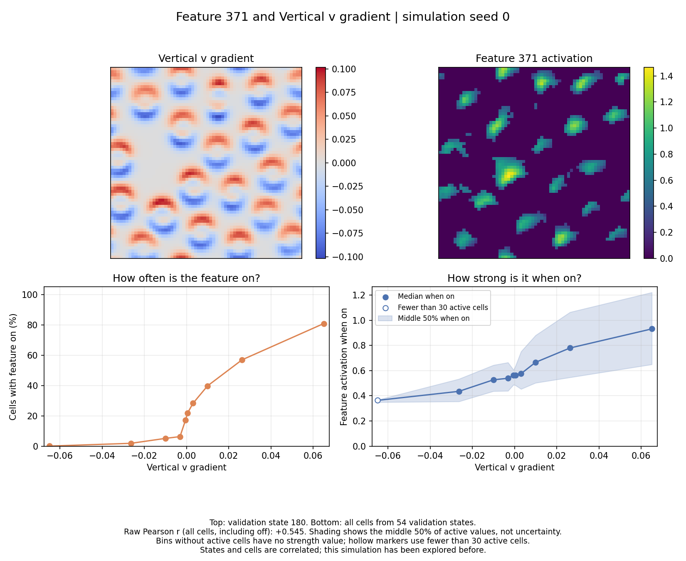
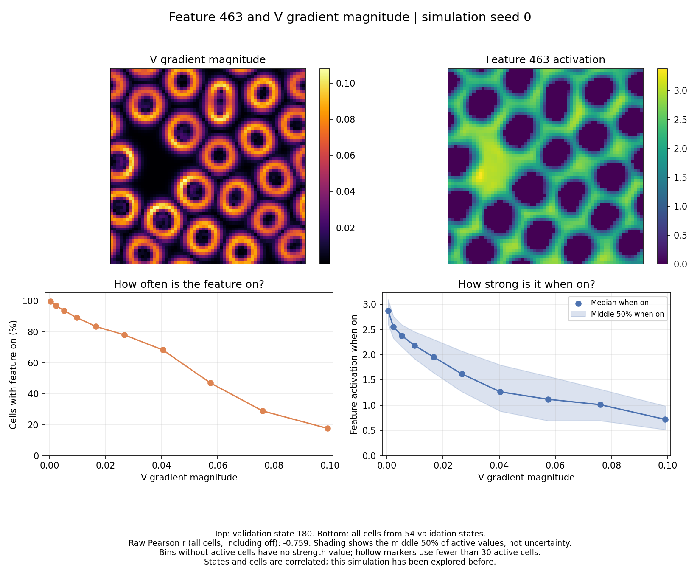
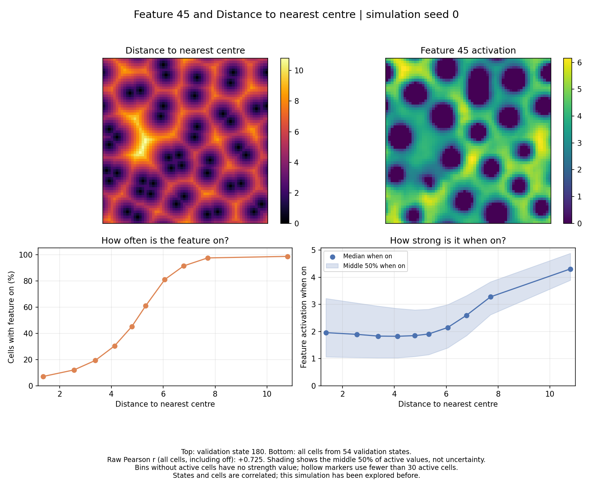
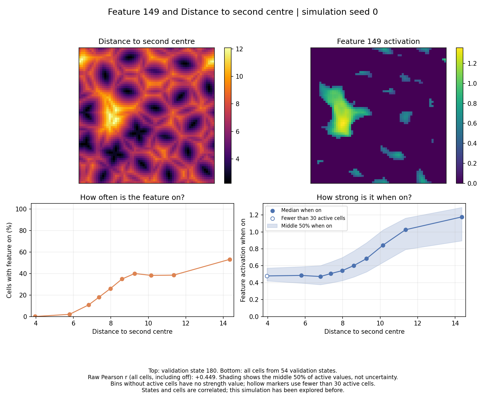
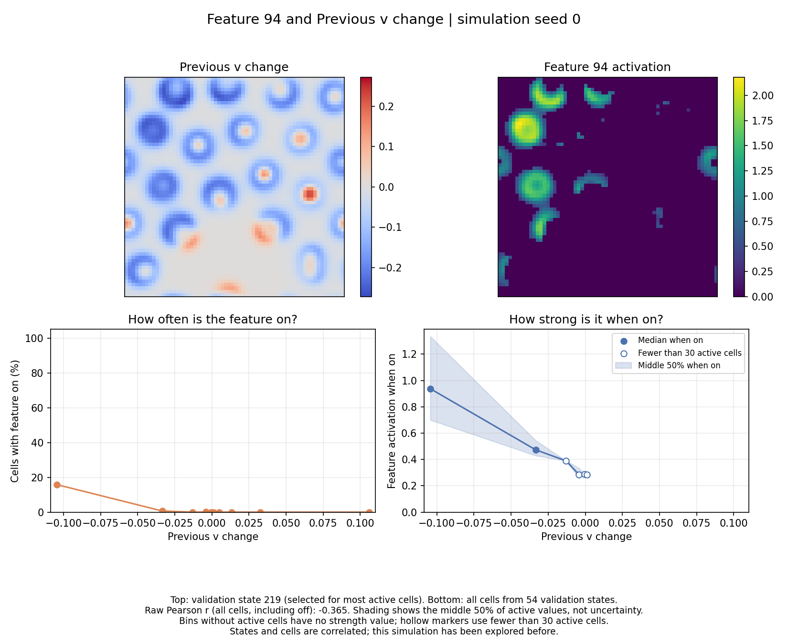
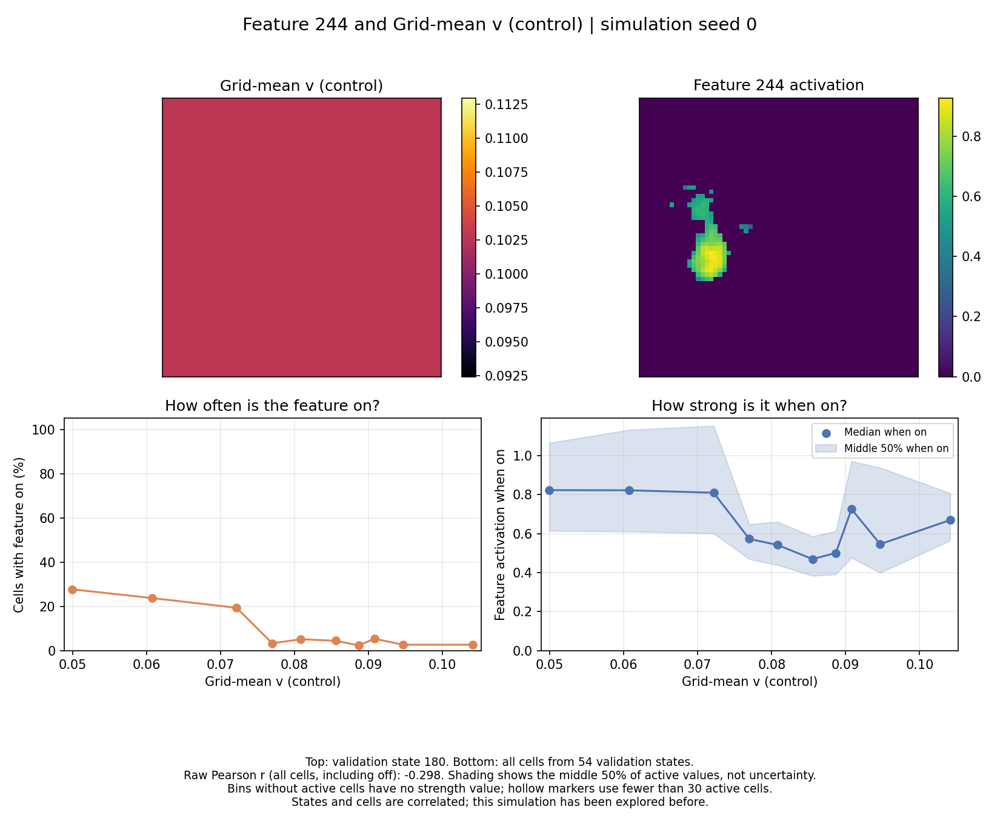
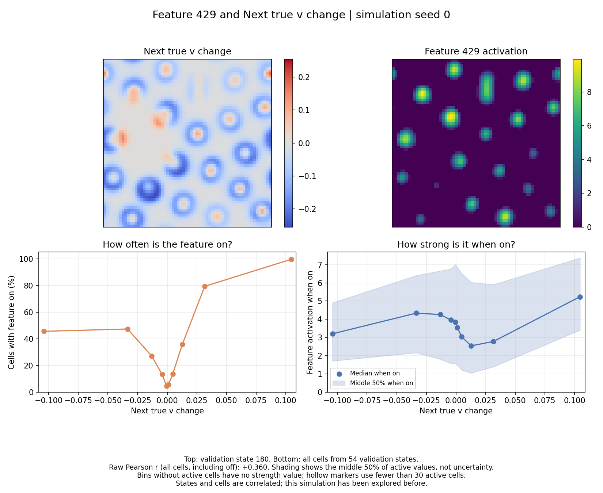

# Exploring block-6 features

[Back to the main README](README.md#52-exploring-features-with-physical-questions)

These plots look more closely at the features associated with the physical questions in the
[overview](README.md#52-exploring-features-with-physical-questions). They describe associations,
not proof that a feature represents only one quantity or causes a physical effect. A feature can
respond to several related properties at once. Blob division is a separate question and is not
studied by these plots.

## How to read the plots

- **Top left:** the physical quantity across one 64 × 64 grid. **Top right:** the feature's
  activation at the same cells and time. Dark purple means the feature is off; colour scales
  differ between panels. Most maps show validation state 180. Feature 94 instead shows a
  deliberately selected state, described below.
- **Bottom left:** group cell observations by the physical quantity; the orange curve shows
  the percentage of each group where the feature is on (activation greater than zero).
- **Bottom right:** for the same groups, the blue curve shows the median activation **only among
  cells where the feature is on**. The shaded band contains the middle 50% of those active
  values; it is not an uncertainty interval. An empty marker means fewer than 30 active
  observations; a group with none has no strength point.

Read both bottom panels together: a feature can have a nonzero typical strength in a group
even if it fires there very rarely. For example, in the highest horizontal-gradient group for
feature 402, only **30 of 22,119 cell observations** are active (about 0.14%); the median on
the right describes only those 30, not the entire group.

The groups are quantile bins: each dot is placed at the mean physical value within its bin,
not at an exact value shared by all its cells. Bins can differ in width, and ties can change
their counts. The [bin data](figures/feature_relationships/bins.csv) contains the bounds,
total and active counts, firing rates and strength summaries. The printed Pearson *r* uses
all valid cell observations, including zeros; it summarises a linear association and does not
describe all the detail in the curves.

The curves pool **54 validation states, indices 180–233, from simulation seed 0**. That gives
54 × 4096 cell observations before exclusions, but neighbouring cells and successive states are
correlated: they are not independent samples. This trajectory and these features have been
explored before, so this is not a blind test. For centre distances, cells in states without
enough detected centres are excluded. Results and example maps need not generalise to other
trajectories.

## Feature 117 — local v



Local *v* is the concentration in the cell itself. Feature 117 is more often on as *v* rises,
and its typical strength also rises. In the example, high activations broadly overlap the
spots. This is a strong association in these states, not proof that the feature encodes
only *v*.

## Feature 159 — v Laplacian



The Laplacian describes how *v* at a cell compares with its spatial neighbours: negative values
often occur around local peaks, positive values around local dips. It is a property of the
current field, **not a change over time**; it contributes to diffusion in the equations.
Feature 159 is on in most cells, so strength is more informative than a simple on/off label.
Its median rises from negative towards moderately positive values, then falls again. It is not
a simple one-to-one Laplacian meter.

## Feature 402 — horizontal spatial gradient



The horizontal gradient compares *v* in the right and left neighbouring cells **at the same
time**: `(v_right - v_left) / 2`, with periodic boundaries. It does not measure movement.
Feature 402 is often on, and typically stronger, when this gradient is negative. It can still
fire in a small number of positive-gradient cells; its strength there must be read alongside
the very low firing rate. This does not establish that it detects every negative gradient.

## Feature 371 — vertical spatial gradient



The vertical gradient is `(v_below - v_above) / 2` in the plotted grid coordinates, again in
one snapshot and with periodic boundaries. Feature 371 tends to be on more often and more
strongly at positive vertical gradients. It is not exclusively active there and is not a
measurement of vertical motion.

## Feature 463 — spatial gradient magnitude



The magnitude combines the horizontal and vertical gradients and measures local spatial
steepness, regardless of direction. It does **not** say whether the field will change later.
Feature 463 is more often on and stronger where the gradient is small; its activation is lower
near steep spot edges. Small gradients can occur in different physical contexts, so the feature
should not be interpreted as a complete description of flat regions.

## Feature 45 — distance to the nearest centre



Distance is measured in grid cells from each cell to the nearest detected spot centre, wrapping
around the grid. Feature 45 fires more often farther from a centre; its typical strength also
increases at larger distances. This is a spatial association with detector-defined centres,
not evidence that a spot is disappearing.

## Feature 149 — distance to the second centre



Here the distance is to the second-nearest detected centre. Firing generally increases with
distance, although it is not monotonic in every bin; strength tends to increase at larger
distances. The nearest and second-nearest distances and other properties of spot arrangements
can co-vary, so this plot alone does not establish which property the feature uses.

## Feature 94 — previous v change



Previous change is current *v* minus *v* one input frame earlier, 100 simulator steps apart;
negative means *v* decreased at that cell. Feature 94 is rare in this window. It fires most
often in the group with the largest decreases, but even there only about 16% of cell
observations are on. Some strength points use very few cells, and bins without active cells
have no point.

The maps show **state 219**, selected from the 54 states because it has the most cells where
feature 94 is on. This makes the feature visible, but is not a typical or randomly chosen
example. The bottom curves still use all 54 states.

## Feature 244 — grid-mean v control



Grid-mean *v* is a single number for the entire snapshot, so its map is necessarily uniform.
In this window, feature 244 fires more often in states with lower grid means, but the
relationship is uneven and its strength does not follow a simple curve. Since all cells in a
state share the same grid mean, this cell-level plot repeats the same value thousands of
times. The association may also reflect changes over the trajectory; it is not evidence that
the feature directly measures the global mean. This comparison is a control, not a clear
physical interpretation of feature 244.

## Feature 429 — next true v change



The target is *v* 100 simulator steps later minus current *v*, from the true simulation,
not from an emulator rollout. In these states feature 429 fires frequently in the largest
positive-change group, but it also fires in some negative-change groups; the strength curve
is not monotonic. This is an association with a future quantity, not proof that activating
the feature causes a change.

## Reproduce the plots

After generating the dataset and training the emulator and block-6 SAE as described in the
[main README](README.md#4-the-sparse-autoencoder), run:

```bash
python feature_relationships.py --data data/gray_scott.npz --model-dir model \
  --figures figures/feature_relationships --state-start 180 --states 54 --threads 4
```

The script writes all ten figures and `bins.csv`. The supplied figures use the saved block-6
checkpoints and seed-0 dataset; retraining can change feature numbers and results.
