# SAE for a Gray-Scott emulator

## Contents

- [Summary](#summary)
- [1. The system](#1-the-system)
- [2. The task and the data](#2-the-task-and-the-data)
- [3. The emulator](#3-the-emulator)
- [4. The sparse autoencoder](#4-the-sparse-autoencoder)
- [5. What the tokens mean](#5-what-the-tokens-mean)
  - [Receptive field](#51-the-receptive-field-measured)
  - [Physical questions](#52-exploring-features-with-physical-questions)
  - [Feature relationship study](#53-feature-relationship-study)
  - [Blob division study](#54-blob-division-study)
- [6. The push](#6-the-push)
- [7. What this means](#7-what-this-means)
- [8. Files](#8-files)

## Summary

A neural network is trained to imitate Gray-Scott, a pair of chemicals that react and diffuse on
a grid. At the parameters used here the chemicals organise themselves into a population of
separate circular **spots** that split, move and disappear, and the emulator is asked to predict
that pattern 100 model steps ahead.

A TopK sparse autoencoder (SAE, 512 directions, 16 on at a time) is then
trained on the emulator's internal activations with no reference to the grid, the equations or the
next state. Its job is to describe what those activations encode. The question this folder
answers is whether any direction acts as a causal control: whether pushing one direction, at one
cell, once, changes the model — and whether that change is what the equations would do.

That question is answerable here because of a property of the system, measured before anything is
trained. Gray-Scott at these parameters is **excitable and bistable**: a disturbance below a
critical amplitude decays to the uniform state, and one above it becomes a spot that persists. A
push therefore has a yes-or-no outcome rather than a small number.

Main results:

| # | result | measurement |
|---|---|---|
| 1 | the system is excitable, with a threshold that was measured | a seeded disc of $v$ survives from amplitude **0.15**, and below that it vanishes without trace |
| 2 | and bistable | **4 of 5** runs from the same 25 discs at different random offsets end in the uniform state $u = 1$, $v = 0$; the fifth keeps a pattern |
| 3 | the emulator is accurate on a single call | test RMSE **0.040**, against **0.516** for repeating the input and **0.997** for the average field |
| 4 | it follows the pattern for ten free calls | validation rollout RMSE **0.684**; coverage **0.119** against **0.120** in the simulator |
| 5 | the block-6 SAE reconstructs the emulator's activations | validation reconstruction score **0.988**; **8** principal components explain 95% of training activation variance |
| 6 | one feature predicts much of local v | feature **117**: R² **0.842**, compared with **0.989** using the original block-6 layer |
| 7 | detected centre events need careful interpretation | a centre appearing or disappearing is not necessarily a blob being born or dying |
| 8 | pushing one does not nucleate a spot in the model | a blob appeared at the pushed cell in **0%** of pairs — the strongest direction, the weakest and a random one alike |
| 9 | the same nudge, given to the equations | **25%** of those nudges nucleate a spot in the **true** system |

**Note:** results 8–9 and sections 6–7 describe the previous four-block emulator, not the
new seven-block emulator in section 3. They have not yet been regenerated for the new model.

## 1. The system

*What to run, to pick the regime by measurement and to produce every number and animation in this
section:*

```bash
../../.venv/bin/python generate_data.py --out data
../../.venv/bin/python generate_data.py --explore --figures figures
../../.venv/bin/python make_fig1.py --data data/gray_scott.npz --model-dir model --out figures
../../.venv/bin/python animate.py --data data/gray_scott.npz --model-dir model --figures figures --only pattern,disc
```

These system experiments run the simulator directly. The regime sweep changes the equation
parameters; the disc experiments start from a uniform grid with one disc; and the bistability
experiment uses several initial-condition seeds. The commands above generate these experiments.
The default dataset supplies settings to `make_fig1.py` and `animate.py`, which simulate the
fields again; using the same seed and settings does not create an independent trajectory.

### 1.1 Gray-Scott

Gray-Scott is a pair of chemicals on a periodic grid of 64 × 64 cells. Both diffuse,
and they react:

$$\frac{\partial u}{\partial t} = D_u \nabla^2 u - uv^2 + F(1-u) \qquad
  \frac{\partial v}{\partial t} = D_v \nabla^2 v + uv^2 - (F+k)v$$

Four terms, and the behaviour is decided entirely by how they balance.

* $uv^2$ — **the reaction**, and the only source of new $v$. It consumes $u$ and produces $v$,
  and it needs *two* copies of $v$ to happen at all, so $v$ catalyses its own production: where
  a little $v$ has appeared, it makes more of itself: this is the term that lets a pattern exist,
  and what makes a spot sustain itself instead of fading;
* $F(1-u)$ — **the feed**. Fresh $u$ is supplied towards $u = 1$, at a rate $F = 0.022$,
  which also sets the timescale on which anything happens;
* $-(F+k)v$ — **the drain**. $v$ leaves at a rate slightly faster than it arrives, $k =
  0.059$ above $F$; this is what stops the reaction from running away, and the balance
  between the feed and the drain decides whether anything happens at all;
* $D_u = 0.16$ and $D_v = 0.08$ — **the diffusion**. $v$ spreads at *half* the speed
  of $u$, and that asymmetry is why there are patterns: a fast-spreading $v$ would spread out
  before it could accumulate, so the reaction would not localise. Diffusion is also the
  only thing that carries information from one cell to another, so it sets the distance over
  which one cell can affect another.

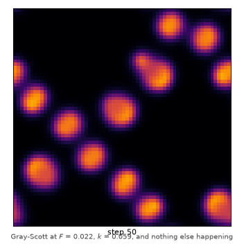

*The system left to itself: spots split, move, merge and disappear, and the grid never settles.
Measurements in `figures/pattern.json`.*

The uniform state $u = 1$, $v = 0$ is a fixed point. It is stable, and that is what makes the next
two sections possible.

### 1.2 The disc-shaped initial condition

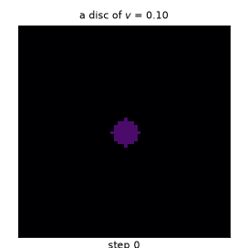
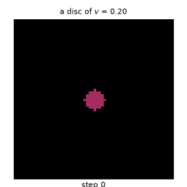

*A disc of $v$ of radius 4 in the uniform state, at two amplitudes, on the same colour scale. At
$v = 0.10$ it is absorbed and the grid returns to $u = 1$, $v = 0$; at $v = 0.20$ it becomes a
spot, still there after 900 steps. Both runs are in `figures/disc.json`.*

Put a disc of $v$ into that uniform state and let the equations run. Either it is absorbed — the
patch decays and nothing marks that it was ever there — or it becomes a **spot**: it climbs
towards $v \approx 0.4$, pulls $u$ down to almost nothing, holds its shape and stays. Which of the
two happens is decided by the disc's amplitude and radius.

Figure 1 measures the threshold: for a disc of each radius, the smallest amplitude of $v$ that
still leaves a spot after 3000 steps.

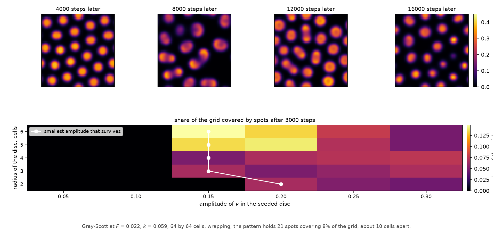

*Figure 1 — the pattern at four moments, and the threshold: the share of the grid covered by
spots after 3000 steps, for a disc of each radius and amplitude, with the smallest amplitude that
survives marked on it.*

The threshold is sharp in amplitude and flat in size: a disc 2 cells across must reach 0.20 in $v$,
every larger disc up to 6 cells only **0.15**. Below 0.15, nothing survives at any size tried.

So a push has a **yes-or-no** outcome: it either changes the pattern for good or does nothing at
all, and §6 measures which one a pushed direction does.

### 1.3 The regime, and why these parameters

$F$ and $k$ choose Gray-Scott's regime. `generate_data.py --explore` walks 24 $(F, k)$ pairs,
integrates each for 8000 steps from the same seeded pattern, and writes a contact sheet: **10
decay** to a uniform grid, **9 fill** with labyrinth, and **5** hold a pattern that keeps changing.
The 19 rejected pairs are unsuitable because a uniform grid or an edge-to-edge labyrinth makes the
prediction close to the identity, so an SAE trained on that layer would describe a near-identity
map.

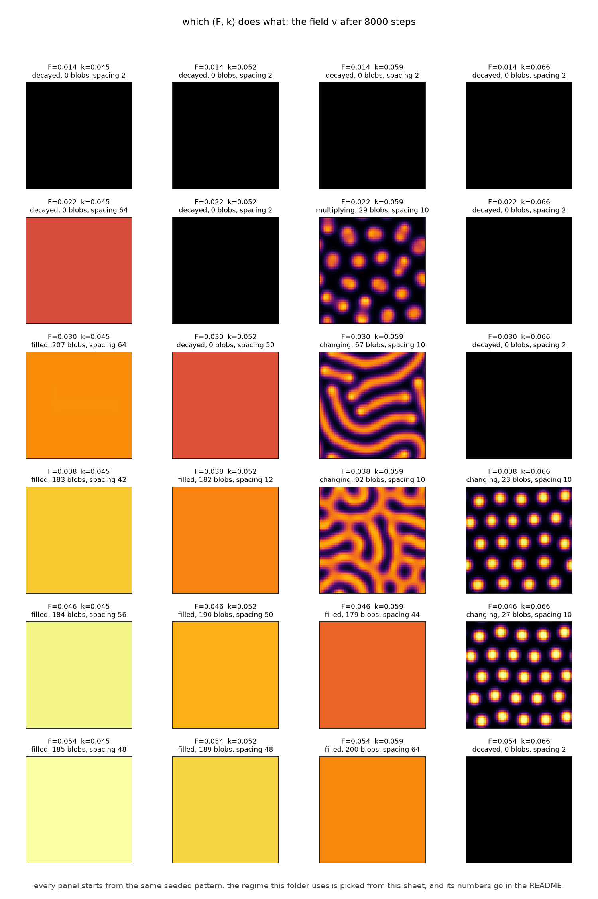

*Figure 2 — the (F, k) plane, one panel per pair, all starting from the same seeded pattern. The
label above each says what happened and what the pattern measures.*

**$F = 0.022$, $k = 0.059$ was picked from that sheet and then checked over a run a hundred times
longer.** It is one of the 5 changing pairs: 21 circular spots covering 0.08 of the grid, about 10
cells apart, appearing and disappearing throughout, so a 100-step prediction is not a copy of the
input.

The regime is also **bistable**, which is what makes §6 answerable. The uniform state $u = 1$,
$v = 0$ is a fixed point, and it is stable: a disturbance below the threshold in §1.2 decays back
to it. A pattern does not decay — once established it sustains itself. Five runs start from the
same 25 discs (radius 3 cells, $u = 0.50$, $v = 0.25$, planted at random offsets on the same
lattice), each integrated for 16000 steps: **four end in the uniform state** — no spots, coverage
0 — and the fifth is the run described above, holding 21 spots. A push can therefore move the
system from one of the two states to the other and leave it there. `make_fig1.py` fixes its seed
and raises if the pattern it drew died.

## 2. The task and the data

### What is a state?

A **state** is a snapshot of the whole 64 × 64 grid at one moment: it contains both $u$ and
$v$ at every cell. It is not a single blob or a single cell. The simulator changes the grid
at every simulation step, and we record one state every **100 steps**.

The emulator's task is to predict the next recorded state. Each input example contains two
states: the **previous** snapshot and the **current** snapshot. The target is the snapshot
100 steps after the current one:

```text
previous state          current state            target state
step t - 100            step t                   step t + 100
└──────────── emulator input ────────────┘
```

In the analyses below, “state” can also be shorthand for an input example containing both
snapshots. A physical quantity or feature map normally refers to the current snapshot.
Consecutive input examples overlap: the current snapshot of one is the previous snapshot of
the next.

**One call is 100 model steps.** With a single-step call the emulator would only have to reproduce
the integrator's stencil cell by cell and there would be nothing to interpret; at 100 steps a spot
can appear, which depends on more than the two fields at that cell. A call is also **17%** of the
600 steps over which the pattern decorrelates, so each prediction is an extrapolation, not a near
copy of the input.

### The default dataset

Run `python generate_data.py --out data` to create `data/gray_scott.npz`. With the defaults,
the simulator starts with initial-condition seed 0, runs for 2,000 warm-up steps, and then
records a further 160,000 steps. The resulting sequence of states is one **trajectory**: one
simulation followed through time.

We split this trajectory into three consecutive blocks:

```text
earlier ── [ training ] ── gap ── [ validation ] ── gap ── [ test ] ── later
```

| Name used below | Input examples | How it is used |
|---|---:|---|
| **Training dataset** | 1,092 | Train the emulator; a subset also provides activations for SAE training. |
| **Validation dataset** | 234 | Monitor training and select the emulator checkpoint; also used in several analyses. |
| **Test dataset** | 233 | Evaluate the trained emulator on a later time block. |

Each example has an input pair and a target. These datasets are **not three separate
simulations**: they are different periods of the same simulation. The configured gaps are
20 recorded positions (2,000 simulator steps); the input and target windows extend around
the block boundaries. The gaps separate the blocks, but the blocks are not
independent trajectories.

Each field is standardised using a mean and standard deviation calculated **only from the
training inputs**: $u$: 0.700 ± 0.189, $v$: 0.081 ± 0.100. Below, “training”, “validation”
and “test dataset” refer to these blocks unless an analysis explicitly describes other data.

**How hard is the task?** Repeating the input costs **0.516** and predicting the average field
0.997, in standardised units, so repeating the input is only half as good as knowing nothing.

The test dataset's coverage runs from 0.013 to 0.204 (mean 0.114), so it holds patterns of
different density rather than copies of one. A low error there shows performance on a later
time block, not necessarily on a new simulation.

### Additional simulations

Some studies also use **new Gray-Scott simulations**, because all three parts of the default
dataset come from the same simulation. Starting from different spot arrangements lets us
check what happens in other trajectories, rather than only later in the original one.

These simulations use the same equations and settings as the default dataset, but different
initial-condition seeds. A seed determines the initial arrangement of spots. In particular,
seeds **9, 14 and 35** are used both to evaluate Figure 8 and as discovery simulations in the
[blob division study](DIVISION_STUDY.md). The division study also uses other seeds for
evaluation and for its second-split analysis; it explains their roles and commands separately.
These seeds were selected because their patterns survived and have been explored before, so
they are not a fresh blind test.

The analysis scripts generate the needed simulations themselves: they read the simulator
settings and training-data normalisation from the default dataset, start with the requested
seed, run the **Gray-Scott simulator**, and record states. They do not train a new emulator.
The same seed and settings reproduce the same trajectory, although different scripts may
record different lengths. The commands in the relevant sections regenerate the data; no
separate saved trajectory files are required.

## 3. The emulator

*What to run:*

Install the dependencies in `requirements.txt` in your Python environment, then run:

```bash
python -m pip install -r requirements.txt
python generate_data.py --out data
python train_emulator.py --data data/gray_scott.npz --model-dir model --figures figures \
  --architecture 32-32-32-32-32-32-32 --dilations 1,2,4,8,4,2,1 \
  --epochs 80 --seed 0 --evaluation-split val --rollout-calls 10
```

This writes the architecture, training and ten-call rollout figures shown below. To reproduce
the 25-call figure as well, run the same training command with a separate figure directory:

```bash
python train_emulator.py --data data/gray_scott.npz --model-dir model \
  --figures figures/rollout_25 --architecture 32-32-32-32-32-32-32 \
  --dilations 1,2,4,8,4,2,1 --epochs 80 --seed 0 \
  --evaluation-split val --rollout-calls 25
```

This second command **retrains the emulator** and replaces the files in `model/`; its
25-call plot is `figures/rollout_25/skill.png`. The rollout length is controlled by
`--rollout-calls` (default: 10), and the results can vary slightly across environments.

### 3.1 Architecture

The system is a torus, so the emulator is a torus.

* each cell carries a **token** of 32 numbers, and all seven blocks are 32 wide;
* an `embed` convolution turns the two fields at the two recorded times — four numbers — into
  that token;
* seven residual blocks, each a convolution with **circular** padding, so the bottom row is next to
  the top one and no cell is special;
* the blocks are **dilated** by 1, 2, 4, 8, 4, 2, 1 cells. Together they reach 22 cells
  to either side, a 45 × 45 theoretical receptive field;
* the head turns the token back into the two fields, and the prediction is added to the last input
  state, so what the network actually produces is the *change* over the 100 steps.

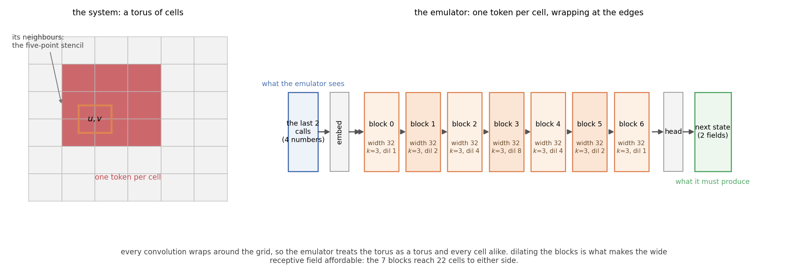

*Figure 3 — the system, and the stack built to imitate it.*

The model has **72,866** parameters. In the recorded run it trained on the training dataset
for 80 epochs on four CPU threads and kept epoch **74**, with the best validation error.

### 3.2 One call

On the test block the emulator's error is **0.040** in standardised units (0.0058 in the fields'
own units), against **0.516** for repeating the input and 0.997 for the average field — about
**13 times** better than repeating the input.

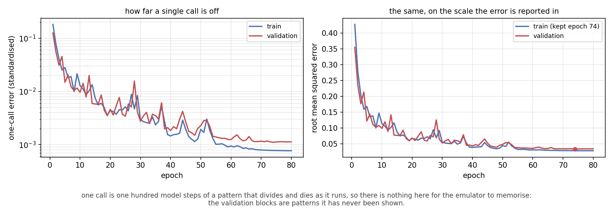

*Figure 4 — training and validation curves for the one-call loss. Left: mean squared error in
standardised units; right: its square root, with the best validation epoch marked.*

The training curves show how the one-call error changes with each epoch. The validation block
is not used for gradient updates, but it is used to choose the saved epoch.

### 3.3 Run on its own

The emulator is trained on one call and judged over many: it is run freely, its own prediction
feeding the next call, against the true system from the same states.

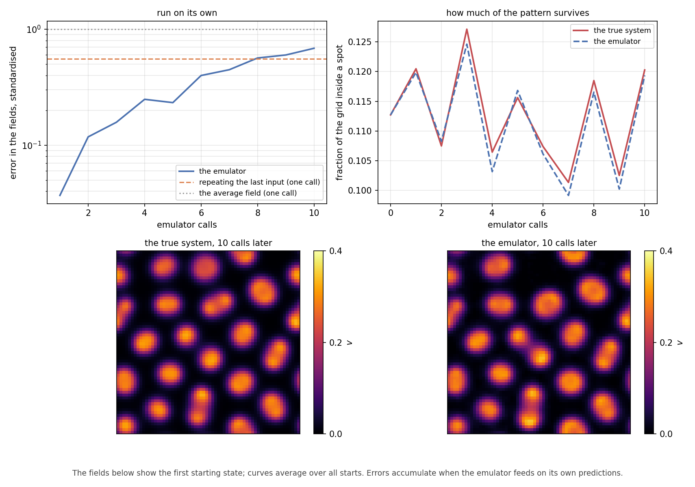

*Figure 5 — free rollout from 16 validation starting states. Top: error and coverage averaged
across starts; the dashed and dotted lines are one-call baseline errors, not rollout baselines.
Bottom: the simulator and emulator fields for the first start after ten calls.*

The standardised RMSE grows from **0.037** after one call to **0.684** after ten.
At ten calls coverage is **0.119** versus **0.120** in the simulator, and the estimated
mean blob count is **31.5** versus **31.0**. These are averages; matching counts does not
guarantee that individual blobs match. The validation data also selected the training
checkpoint, so this is not an independent test of model selection.

We focus on ten calls (1,000 simulator steps): this is a useful short horizon for this
evolving, chaotic pattern, where small errors can grow over time. Agreement over ten calls
is encouraging, but does not establish accuracy over longer rollouts.

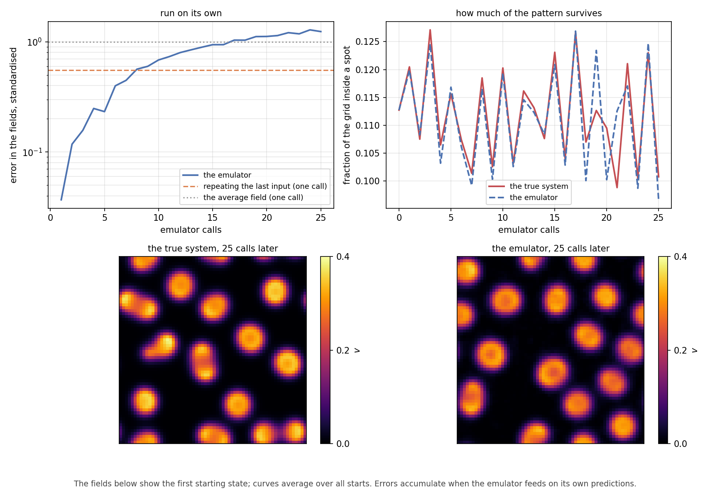

*Figure 5b — the same validation starting states, after 25 calls. The curves average over
the 16 starts; the fields show the first start.*

After **25 calls**, standardised RMSE rises to **1.237**. Mean coverage is **0.097** for
the emulator versus **0.101** for the simulator, but the example fields no longer match
well in detail. Similar coverage alone is not evidence that the emulator tracks individual
spots indefinitely. These comparisons use simulator continuations from validation starts;
the longer continuations can extend beyond the validation block.

## 4. The sparse autoencoder

*What to run:*

```bash
python train_sae.py --data data/gray_scott.npz --model-dir model --figures figures \
  --layer blocks.6 --n-latent 512 --k 16 --epochs 120 --train-states 300 \
  --val-states 60 --seed 0 --threads 4
```

First generate the data and train the emulator as described in section 3. The SAE reads the
saved `model/emulator.pt`; it does not retrain the emulator.

An SAE is a second, separate network with one job: rebuild a token, the 32 numbers at one
cell in the emulator's layer `blocks.6`. It has 512 learned **directions**, each 32 numbers
long. For each token, the encoder keeps at most 16 nonzero feature activations; the decoder
combines their directions to rebuild the token. It is trained on the emulator's activations,
without physical labels or the next state.

The layer is the last of seven blocks. Its theoretical receptive field is 45 × 45 cells, so
each token can depend on a wider region around its cell.

Two useful checks are:

* **Reconstruction:** `1 - mean squared reconstruction error / mean activation variance`.
  The scores are **0.989** on training tokens and **0.988** on validation tokens. A score of
  1 is perfect; high reconstruction alone does not establish that the features have clear
  physical meanings.
* **PCA:** on the training activations, **8 of 32** principal components explain 95% of
  the variance and **19** explain 99%. PCA summarises the variation in the original tokens;
  its components are not the SAE's sparse features.

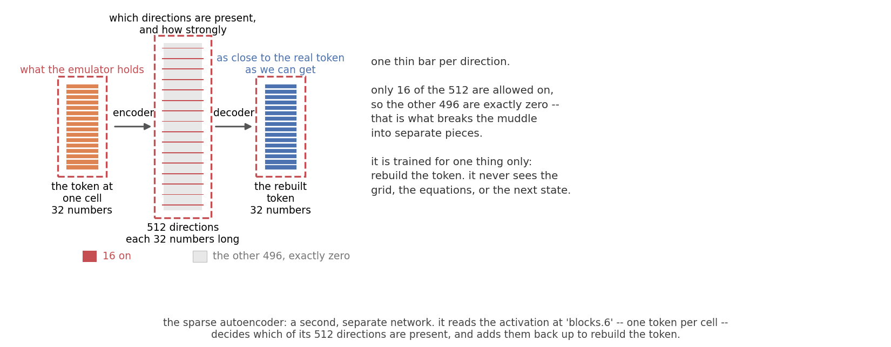

*Figure 6 — a second, separate network that reads one layer and rebuilds it. It never sees the
grid, the equations, or the next state.*

The dictionary was trained on **1,228,800** tokens from part of the training dataset and
checked on **245,760** tokens from part of the validation dataset. Each input example produces
one token per grid cell. The validation data were also used to monitor SAE training, so they
are not a final independent test. In the recorded run, all 512 features fired at least once
on training tokens.

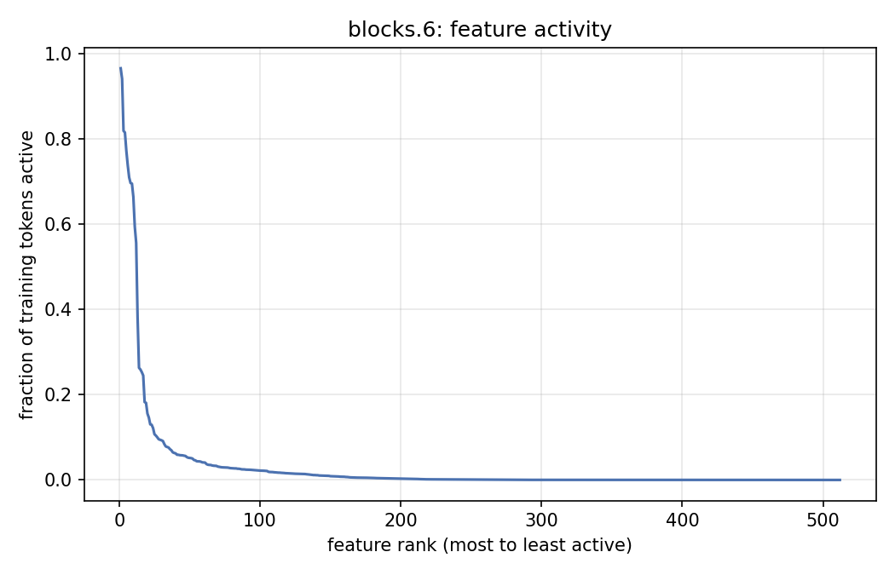

*Feature firing rates on the training tokens, sorted from most to least frequent. The x-axis
is a rank, not a feature number; the y-axis is the fraction of cells where a feature is on.*

Some features are active in many cells, while **366 of 512** are active in fewer than 1%
of the training tokens. Rates close to zero can be hard to distinguish on this linear scale;
a rare feature is not necessarily a feature for a rare physical event.

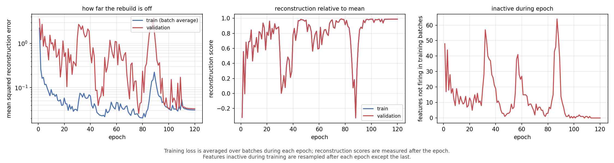

*SAE training on block 6. Left: mean squared reconstruction error (training batch average
and validation at the end of each epoch). Middle: reconstruction scores on both sets.
Right: features that never fired during the training batches of each epoch.*

The curves fluctuate considerably before settling. Features that do not fire during an epoch
are resampled after that epoch, except the last. This resampling can change reconstruction
and is a plausible contributor to the spikes. The training command above generates all three
SAE figures.

## 5. What the tokens mean

### 5.1 The receptive field, measured


The architecture says a block-6 token can be affected by cells up to **22 cells away** in
each direction. To check the horizontal profile, we perturb both fields at one cell in both
input frames by +0.5 or −0.5 standard deviations, run the emulator, and compare the block-6
tokens along the same row. This is a measurement of the emulator's response, not an injected
blob event. The inputs come from part of the validation dataset.

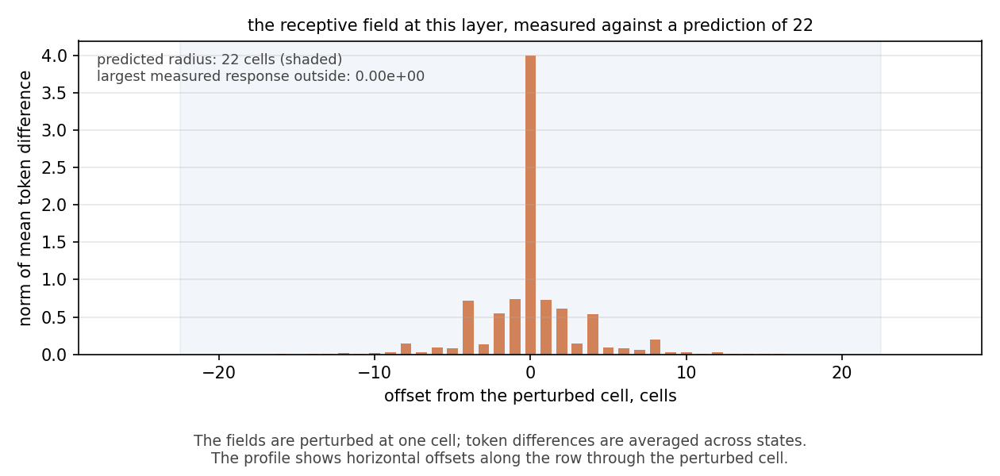

*Figure 7 — the norm of the mean token difference across 120 validation states, at each
horizontal offset from the perturbed cell. The shaded region is the theoretical radius.*

As expected, no response was measured outside the predicted radius along this horizontal
line. This is the expected, reassuring result: the measured response stays within the
architecture's predicted receptive field. Responses near the centre are much larger than
those near the edge; this single perturbation and profile do not measure every input or
spatial direction.

After training the emulator and SAE as described above, reproduce the figure with:

```bash
python interpret.py --data data/gray_scott.npz --model-dir model --figures figures \
  --state-start 60 --states 120 --receptive-field-only --threads 4
```

### 5.2 Exploring features with physical questions

Figure 8 asks: **can the emulator's internal activations be used to predict a physical
quantity**, such as local $v$ or its spatial gradient? We want to see whether a relationship
found in the original simulation also appears when the spots start in a different arrangement.
The procedure is:

1. **Choose and fit on the default validation dataset.** Feed its simulator states into the
   trained emulator and pass the block-6 activations through the trained SAE. At each cell,
   compare the SAE features with the physical quantity calculated from the simulator.
   For each quantity, select the single feature with the best linear fit and fit a simple
   readout from it. Also fit readouts using all 512 SAE features together and the original
   32 block-6 values.
2. **Check on three additional simulations.** Generate Gray-Scott trajectories with seeds
   9, 14 and 35, as described in [Additional simulations](#additional-simulations).
   Feed their simulator states into the **same trained emulator and SAE**, then apply the
   readouts fitted in step 1. Compare their predictions with the physical quantities calculated
   from the new simulator states.

We do not retrain the emulator, SAE or readouts on those three simulations. The new states
come from the Gray-Scott simulator, not from a free-running emulator rollout. Using different
simulations tests whether the associations extend beyond the trajectory used to fit them;
it does not establish that a feature causes the physical behaviour.

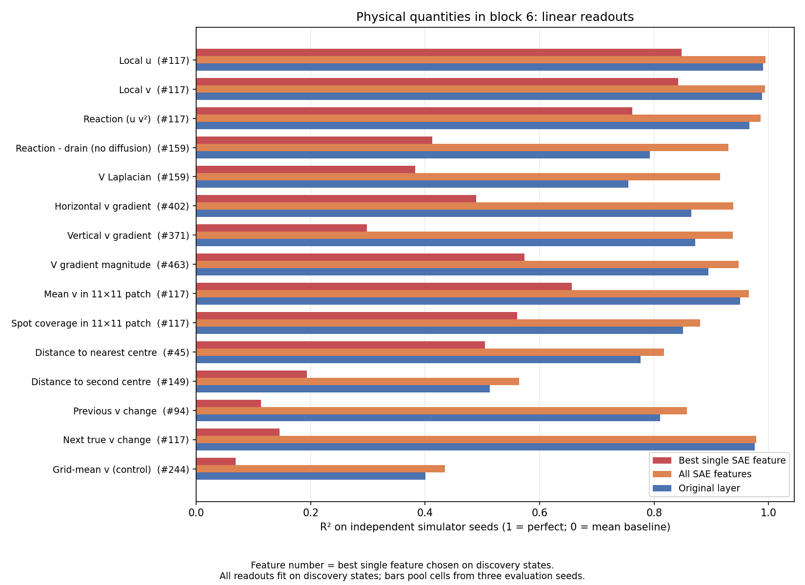

*Figure 8 — pooled R² across three simulator seeds. R² of 1 is perfect and 0 matches predicting
the evaluation-set mean; negative values are possible. The number in each row is the selected
single feature. Gradients are spatial, not velocities.*

For example, feature **117** predicts local v with R² **0.842**, while all SAE features together
reach **0.994** and the original layer reaches **0.989**. Other features seem to have lower R², and they will be studied more deeply in the following section.

The R² values do not show whether an association is positive or negative.

Reproduce Figure 8 and its per-seed scores with:

```bash
python physical_probes.py --data data/gray_scott.npz --model-dir model --figures figures \
  --seeds 9 14 35 --states 150 --threads 4
```


We can also look at where features activate across the grid:

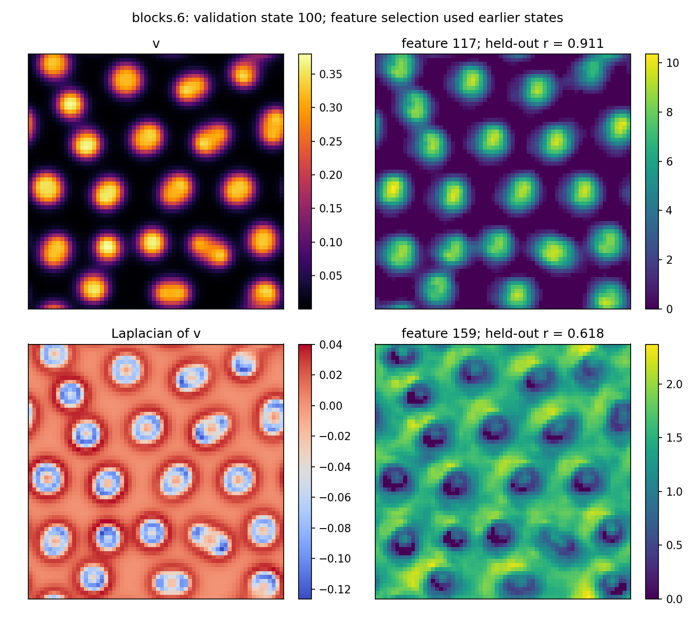

*Figure 8b — one validation state. The left panels show v and its spatial Laplacian; the
right panels show the corresponding SAE feature activations. Each panel has its own colour
scale. The displayed Pearson correlations r are calculated across 40 evaluation states,
not just the state shown.*

These plots show that feature 177 closely tracks the local v value, while feature 159 closely tracks its spatial Laplacian.

Here, the spatial Laplacian of v is \(\nabla^2 v = \partial^2 v/\partial x^2 + \partial^2 v/\partial y^2\): it measures how v at a point differs from nearby values (local curvature), not how it changes over time.

For this figure, both groups come from the **validation dataset**, not the three additional
simulations used for Figure 8. We select each feature by its correlation with the quantity on
one part of that dataset, then calculate its correlation on a later part. Both parts come from
the same trajectory, and adjacent inputs at the boundary share a snapshot. Reproduce the figure
with:

```bash
python feature_maps.py --data data/gray_scott.npz --model-dir model --figures figures \
  --fit-start 60 --fit-states 40 --eval-states 40 --threads 4
```


### 5.3 Feature relationship study

For a closer look at each selected feature, see the **[feature relationship study](FEATURE_STUDY.md)**.
It compares feature maps, firing frequency and activation strength against continuous physical
quantities, with an explanation and a plot for each feature. It uses part of the validation
dataset; the linked study gives the reproduction command.

### 5.4 Blob division study

See the **[blob division study](DIVISION_STUDY.md)** for candidate division sequences,
feature time courses, an exploratory waist scan, and a comparison of sequential
second splits with ordinary splits. It also studies two-peaked “dumbbells”: feature 81 and
other candidates are compared in matched persistent and splitting shapes, and all 512
features are checked for activity exclusive to the persistent examples. None was exclusive in
the sampled waists. The study generates additional simulations rather than detecting these
events in the default dataset; the linked document explains the data, limitations and commands.

## 6. The push

*What to run:*

```bash
../../.venv/bin/python perturb.py --data data/gray_scott.npz --model-dir model --figures figures
```

This section tests the causal question. Everything above describes what the SAE found; this asks
whether any direction acts as a causal control on the model, and whether the resulting change is
what the equations would produce. The script ranks directions on part of the validation
dataset, then starts paired experiments from the test dataset. For the comparison with the
equations it runs the simulator forward from those test states after adding the nudge. As noted
in the summary, the reported results are for the previous four-block model; running the command
with current checkpoints is a new experiment, not a reproduction of those numbers.

### 6.1 Which directions matter

Every one of the 512 directions is pushed at every cell by 0.25 of the token's own size, and the
change in the predicted next state is recorded. Random directions of the same size are pushed the
same way, as the control.

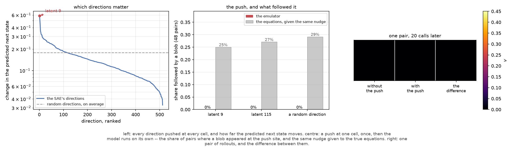

*Figure 9 — left: every direction pushed, ranked, against random directions of the same size.
Centre: a push at one cell, once, then what followed it — in the model, and in the equations.
Right: one pair of rollouts, and the difference between them.*

The strongest direction changes the predicted next state by 0.587 (RMS), the median direction by
0.128, and the weakest by 0.033 — a factor of 18 between the ends. Random directions average
0.178, and the best of the 64 reaches 0.405, so the strongest direction changes the prediction 1.4
times as much as any random one.

### 6.2 One push, at one cell, once

The push is applied on the first call only, and from there the model runs on its own. The question
is the one §1.2 makes answerable: did a blob appear where there was none?

It is asked **paired** — the same state, the same cell, with and without the push — so that a blob
which was going to appear anyway is not credited to the push. In none of the 48 pairs did a blob
appear at the push site: not for the strongest direction, not for the weakest, not for a random
one of the same size. At this push size, the strongest direction of the dictionary does not
nucleate a spot in the model.

The controls make the proportion interpretable; a proportion alone would not be, since in an
excitable system a blob can appear without any push at all.

### 6.3 The same nudge, given to the equations

The equations cannot be given a change to the emulator's activations, but the difference the push
makes to the predicted field *is* a perturbation of the two fields. That can be measured: its
shape, its size, and what the **true** system does when it is added to the real state and
integrated for the same 20 calls.

The nudge a push is equivalent to has a peak of 0.4839 in $v$, three times the 0.15 that a disc
needs to survive (§1.2). Given that nudge, the true system grows a blob in **25%** of cases,
against 29% for the random direction's nudge: the strongest direction of the dictionary is no
better than a random perturbation of the same size.

## 7. What this means

Three things can be said.

**The regime makes the causal question well posed.** The threshold in §1.2 and the second
long-lived state in §1.3 are what make the question answerable: in a single chaotic attractor
every push perturbs a trajectory and none changes anything permanently, so *did the push do
something?* would have no yes-or-no answer.

**The dictionary describes the layer but is not a basis for the physics.** It rebuilds the token
almost exactly (0.996), and all 512 directions together recover the layer's physical content. A
single direction, however, recovers 0.128 to 0.842 of the non-control quantities present in the
layer at R² 0.558–0.992 — as §4 predicted, since the token needs 8 directions for 95% of its
variance.

**Causal control is distinct from description.** The quantities in §5.2 are read from the
activations; the push in §6 modifies them. §6.2 finds no nucleation in the model for any
direction, and §6.3 finds no advantage over a random perturbation of the same size, so neither
supports the inference that a direction which reads local spot density and changes the forecast
when pushed is the mechanism by which the model grows spots.

### 7.1 Limitations

* **One regime, one layer, one size of push.** Everything here is $F = 0.022$, $k = 0.059$,
  `blocks.2`, and a push of 0.25 of the token's size. §1.3 shows that at a neighbouring $(F, k)$
  the pattern freezes and there is nothing to push; the size of the push was not swept.
* **The pairing controls for the model, not for the world.** The paired contrast removes blobs that
  were going to appear anyway *in the model's own rollout*. It cannot remove the possibility that
  the emulator's error and the push interact, and it says nothing about whether a real Gray-Scott
  experiment would respond to a nudge applied to a network.
* **The events are defined by a detector.** A centre is detected from local maxima above a
  threshold. A different detector can give different event labels.
* **The nudge is the emulator's, not an experiment's.** §6.3 adds the field difference the push
  makes to the true state, which is a translation: the push acts on a network's activations, and
  the equations are only ever given the resulting change in the field.

## 8. Files

| file | what it does |
|---|---|
| `generate_data.py` | simulates Gray-Scott, walks the (F, k) plane to pick a regime, builds the split dataset |
| `train_emulator.py` | the circular-convolution emulator: architecture figure, training, one-call metrics, free rollouts against two trivial forecasts |
| `train_sae.py` | the TopK SAE on one layer's tokens: training, reconstruction, firing rates, principal dimension |
| `interpret.py` | the receptive field, the quantities a token holds, and whether a direction can see a blob being born |
| `physical_probes.py` | linear readouts of physical quantities from SAE features and layer tokens |
| `feature_maps.py` | feature maps alongside local v and its Laplacian |
| `feature_relationships.py` | feature maps and binned firing and strength plots for the [feature study](FEATURE_STUDY.md) |
| `block6_division_study.py` | simulate and detect candidate divisions and find matched controls |
| `block6_clean_division_features.py`, `block6_waist_scan.py` | reproduce the feature time courses and waist comparisons in the [division study](DIVISION_STUDY.md) |
| `block6_sequential_division.py` | reproduce sequential-split examples and the feature-213 triplet plot |
| `block6_dumbbell_study.py` | reproduce two-peak examples, matched feature comparisons and the all-feature rarity screen |
| `perturb.py` | ranks the directions, then pushes one at one cell and asks what followed, in the model and in the equations |
| `make_fig1.py` | the system figure and the measurements that go with it: the pattern, the threshold map, and the two long-lived states |
| `animate.py` | the moving pictures: the system running, each disc-shaped initial condition, the emulator's own rollout, and one push |

Artifacts: `data/gray_scott.npz`; `model/emulator.pt` with `metrics.json` and `history.json`;
`model/sae.pt` with `sae_metrics.json` and `sae_history.json`; `model/interpret.json`;
`model/perturb.json`; `model/system.json`; `figures/regimes.json`; `figures/pattern.json` and
`figures/disc.json`; `figures/*.png` and `figures/*.gif`.

`interpret.py` and `perturb.py` read `model/sae.pt`; `make_fig1.py` regenerates the system from
the dataset settings. Environment: NumPy, PyTorch, Matplotlib (`requirements.txt`), single
process, CPU only. Timings on four CPU threads: emulator 2308 s, SAE 1351 s, `interpret.py`
2 min, `perturb.py` 3 min, other scripts under 1 min.
