# Learning a stick feature and using it in Gray-Scott

*This analysis was developed separately and now lives in `new_feature_push_analysis/`. Code,
model, data and figures are in that folder; run the commands below from it.*

## Contents

- [Summary](#summary)
- [1. The system and the two regimes](#1-the-system-and-the-two-regimes)
- [2. Prediction task and mixed data](#2-prediction-task-and-mixed-data)
- [3. Regime-conditioned emulator](#3-regime-conditioned-emulator)
- [4. Sparse autoencoder](#4-sparse-autoencoder)
- [5. A direction for elongated shape](#5-a-direction-for-elongated-shape)
- [6. Holding the stick feature on](#6-holding-the-stick-feature-on)
- [7. What the measurements say](#7-what-the-measurements-say)
- [8. Limitations](#8-limitations)
- [9. Methods and files](#9-methods-and-files)

## Summary

Gray-Scott at `F = 0.026`, `k = 0.059` forms compact blobs; at `F = 0.036`, `k = 0.062` it
forms a stick-rich mixed regime with separate sticks and blobs. We train a regime-conditioned
emulator on both. We then train a sparse autoencoder (SAE) on its block-6 tokens: one 32-number
token per cell, a dictionary of 512 directions.

**Learning the feature.** We measure elongation per connected component (§1.1) and describe each
component by area, solidity, skeleton length/width and branch points. A stick has `E ≥ 3` and
solidity `≥ 0.7`; a blob has `E ≤ 1.6` and solidity `≥ 0.7`; a branched network with solidity
`< 0.5` is labelled labyrinth and excluded. The main comparison is within the stick-rich regime:
486 sticks against 486 matched blobs. Both classes come from the same regime, so the
regime cannot explain a difference; size is only partly matched because the regime has fewer
blobs than sticks. A second comparison repeats this in the blob regime (62 sticks vs 62 blobs).
We score each direction by component-mean AUROC, the probability that a stick component's mean
activation exceeds a blob's. Because the score takes the maximum over 512 directions, we compare
it with a permutation null and a component bootstrap (§5.2).

**Using the feature.** We take the selected feature's activation on a real stick, mask it and
normalise the peak to 1, and move it to three sites in a blob-regime state. At every call we
encode the block-6 tokens with the SAE, add `4m A(x)` to the stick latent, and decode, where
`m` is the mean token norm. The control runs the same encode/decode path with no added
activation. We follow the state for 20 calls.

**Result.** Direction **159** separates sticks from blobs: AUROC **1.000** on validation and
**1.000** on test, permutation p = 0.001, bootstrap CI 1.000–1.000. Its activation is 2.75 on
stick components and 2.05 on matched blobs; the reverse direction 74 has activation 0.48 on blobs
and 0.22 on sticks. A simple linear readout of the token reaches AUROC 1.000 for the stick/blob
label and R² 0.98 for elongation. The direction works almost perfectly inside the stick regime,
but not in the blob regime (0.534 test), so the representation depends on the regime.

Holding the stick latent on works. Near the three sites, the share of cells in elongated
components rises from 2.9% without the push to 14.8% with it (+11.9 percentage points
[10.0, 13.7]), and 88.3% of the 120 states [82.5, 93.3] end with more sticks near a site than
their control. The number of elongated components near a site rises from 0.38 to 2.22. The
share peaks at 26.1% around call 8 and settles near 15%; the effect is visible from call 5.
Adding `v` at the same sites does not reproduce the early effect: a random pattern does
nothing by call 8, and a stick-shaped pattern creates sticks more slowly (10.8% by call 8).

## 1. The system and the two regimes

Gray-Scott on a periodic 64 × 64 grid:

$$\frac{\partial u}{\partial t} = D_u \nabla^2 u - uv^2 + F(1-u), \qquad
  \frac{\partial v}{\partial t} = D_v \nabla^2 v + uv^2 - (F+k)v,$$

with `D_u = 0.16`, `D_v = 0.08`. Only `uv²` creates `v`; `F(1-u)` feeds `u`; `(F+k)v` drains
`v`; diffusion moves `u` and `v` between cells. The uniform state `u = 1`, `v = 0` is stable, and
a disturbance above a threshold becomes a self-sustaining component — a connected patch of
`v > 0.25`, defined in §1.1.

### 1.1 Elongation and morphology classes

We measure elongation for a connected component, not for a single cell. We threshold at
`v > 0.25`, take four-connected components on the periodic grid, and discard components with
fewer than 8 cells. We unwrap each component's coordinates around one reference cell and compute
the centroid and covariance:

$$\bar r = \frac1m\sum_i r_i,\qquad \bar c = \frac1m\sum_i c_i,\qquad
  \Sigma = \frac1{m-1}\sum_i \begin{pmatrix} r_i-\bar r \\ c_i-\bar c\end{pmatrix}
  \begin{pmatrix} r_i-\bar r & c_i-\bar c\end{pmatrix}.$$

If `λ₁ ≥ λ₂ > 0` are the eigenvalues of `Σ`,

$$E = \sqrt{\frac{\lambda_1}{\lambda_2}}.$$

The eigenvalues are the variances along the two principal axes. A disc has `E ≈ 1`; a rectangle
`L × W` has `E ≈ L/W`, so the `12 × 3` perturbation of §1.3 starts near 4. A bent or branched
component can have large `E` without being a straight stick, because only second moments are
used.

`E` is only one descriptor. A long curved or branched network can have `E ≈ 1` while every local
branch looks elongated, so `E ≈ 1` is not a blob indicator. We therefore also record:

- **solidity** — area divided by convex-hull area (near 1 for a convex blob, low for a branched
  network);
- **skeleton length, width and branch points** — from a Zhang-Suen skeleton of the component.

The morphology classes are:

| class | rule | meaning |
|---|---|---|
| **blob** | `E ≤ 1.6`, solidity `≥ 0.7`, area 8–200 | compact and convex |
| **stick** | `E ≥ 3`, solidity `≥ 0.7` | elongated and convex |
| **labyrinth** | solidity `< 0.5` | long curved/branched network, any `E` |
| **other** | remainder | ambiguous, excluded |

The study compares **sticks with blobs**, so we usually ignore the labyrinth. A binary blob
indicator is 1 for the blob class and 0 for stick, labyrinth and other. Every cell inherits its
component's class; empty cells are `none`. The right column of Figure 1 shows elongation only,
not a blob indicator; in the stick row, the `E ≈ 1` bars are blob-class components.

### 1.2 The two regimes

| regime | `F` | `k` | coverage | components | elongation median | elongation max | covered cells with `E ≥ 3` |
|---|---:|---:|---:|---:|---:|---:|---:|
| blob | 0.026 | 0.059 | 0.171 | 24 | 1.19 | 2.62 | 0.06 |
| sticks | 0.036 | 0.062 | 0.255 | 19 | 4.02 | 8.87 | 0.74 |

*Coverage is the fraction of cells with `v > 0.25`; components are the four-connected components
of those cells (§1.1). The table reports the median over 20 sampled states per regime (seed 0),
starting from 25 discs of radius 3 at `u = 0.50`, `v = 0.25`.*

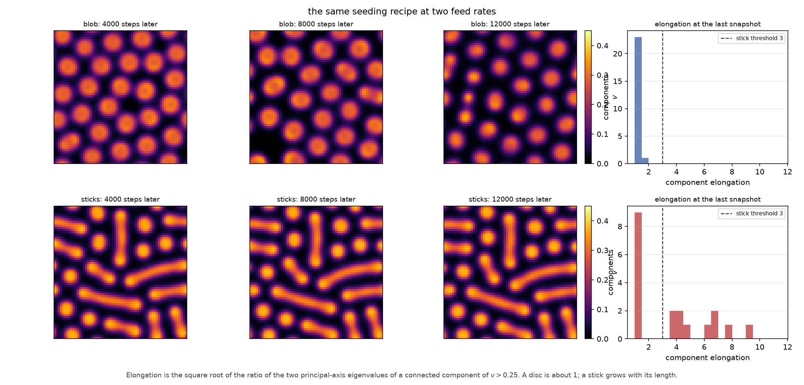

*Figure 1 — the blob regime (top) and the stick regime (bottom), with the component elongation at
the last snapshot. This panel is elongation only; it is not a blob indicator. In the stick row the
`E ≈ 1` bars are blob-class components and the high-`E` bars are separate sticks; §1.1 defines
the morphology classes.*

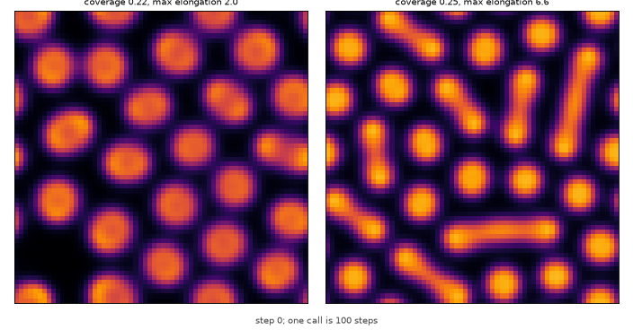

*Animation 1 — the same seed at `F = 0.026` (left) and `F = 0.036` (right) for 4 000 steps.*

Over the recorded trajectories, a component with `E ≥ 3` is present in 40% of blob states and
100% of stick states; the median maximum elongation is 2.62 in the blob regime and 8.87 in the
stick regime.

Almost all components in the blob regime are blob-class. The stick-rich regime contains separate
sticks and blobs, with no labyrinth class. Across the validation states
used later for the feature analysis (§5), the blob regime supplies 4 965 blob-class components
and 62 sticks; the stick regime supplies 540 sticks and 486 blob-class components.

### 1.3 A stick-shaped perturbation

We plant a `12 × 3` rectangle of `v = 0.5`, `u = 0.50` at least 7 cells from any component, on a
run settled for 8 000 steps. The table gives the largest elongation within 10 cells of the site,
averaged over 3 seeds.

| `F` (`k = 0.059`) | 500 steps | 1 000 steps | 2 000 steps | 4 000 steps |
|---:|---:|---:|---:|---:|
| 0.022 | 0.50 | 0.38 | 0.39 | 0.50 |
| 0.024 | 0.83 | 0.88 | 1.00 | 1.18 |
| **0.026** | **1.90** | **1.91** | **1.45** | **0.95** |
| 0.028 | 2.84 | 3.51 | 3.01 | 1.37 |
| 0.030 | 0.73 | 0.88 | 3.06 | 3.17 |

The sweep uses `k = 0.059`. In the blob regime (`F = 0.026`) the perturbation stays elongated
for 500–1 000 steps and has decayed by 4 000. At `F = 0.022` it is never elongated; at `F = 0.030`
the background already contains sticks, so the measurement at the site does not isolate the
perturbation. The study's stick regime is `F = 0.036, k = 0.062` (§1.2), where the background is
stick-rich, so the perturbation is not an isolated transient.

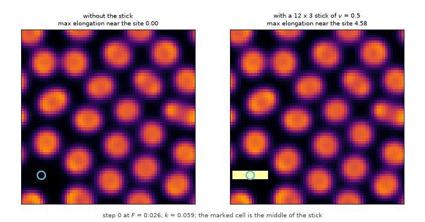

*Animation 2 — the blob regime without (left) and with (right) a `12 × 3` stick of `v = 0.5`.
It starts at elongation 4.58 and has decayed by the end of the 1 200 animated steps.*

### 1.4 The threshold

A disc of radius 2 needs `v = 0.20` to survive; radii 3–6 need `v = 0.15`; below 0.15 nothing
survives. The measurement is in `model/threshold.json`.

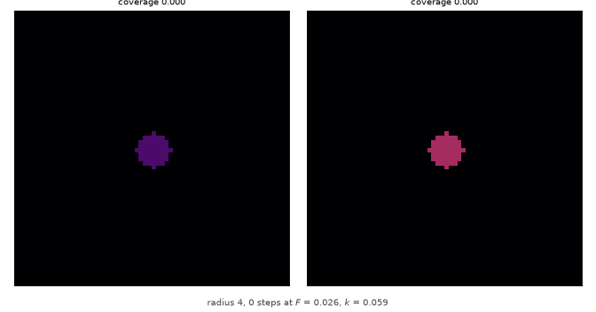

*Animation 3 — a radius-4 disc at `v = 0.10` (left, absorbed) and `v = 0.20` (right, becomes a
spot), for the same 900 steps.*

## 2. Prediction task and mixed data

One emulator call advances 100 model steps. Given the state now and one call ago, the emulator
predicts one call ahead. The blob regime decorrelates by half after 1 400 steps, so a call is 7%
of that time; the stick regime's half-time is 5 000 steps, so a call is 2%.

The dataset contains one 160 000-step blob trajectory and one 40 000-step stick trajectory. We
record every 100 steps, split each trajectory into contiguous blocks, and join them with an
integer `regime` label:

| split | blob examples | stick examples | total |
|---|---:|---:|---:|
| train | 1 092 | 252 | 1 344 |
| validation | 234 | 54 | 288 |
| test | 233 | 53 | 286 |

We standardise with the combined training inputs: `u = 0.625 ± 0.172`, `v = 0.119 ± 0.110`.
We keep the regime index separate.

## 3. Regime-conditioned emulator

*What to run:*

```bash
../../../.venv/bin/python train_emulator.py --data data/gray_scott_mixed.npz --model-dir model \
  --figures figures --architecture 32-32-32-32-32-32-32 --dilations 1,2,4,8,4,2,1 \
  --epochs 80 --seed 0 --rollout-regime 0 --rollout-calls 10 --threads 6
```

We train an emulator to reproduce the dynamics. It takes the two recorded states and predicts
the next one. After training, we run it forward on its own predictions rather than on recorded
states. This section describes the architecture and how well it holds the two regimes.

The system is a torus, so the emulator uses circular padding. An `embed` convolution turns the
two fields at the two recorded times into a 32-number token per cell; seven residual blocks
update it; the head predicts the change over 100 steps. Dilations `1,2,4,8,4,2,1` give a
45 × 45 receptive field (the grid region that can influence one token). We add a learned regime
vector to every token after the embedding, so the same weights hold two transition rules.

We train one-call regression in standardised units and keep the best validation epoch. The
recorded run trained for 80 epochs in 3 795 s and kept epoch 71. Test one-call RMSE
(root-mean-square error in standardised units) is **0.0329** overall, **0.0362** in the blob
regime and **0.0094** in the stick regime, against 0.4942, 0.5476 and 0.0028 for repeating the
input. In a free rollout,
where we feed the prediction back as the next input at every call, RMSE grows from 0.0209 after
one call to 0.0912 after five and 0.4275 after ten. At ten calls coverage is 0.174 against
0.172, and component count 41 against 41.

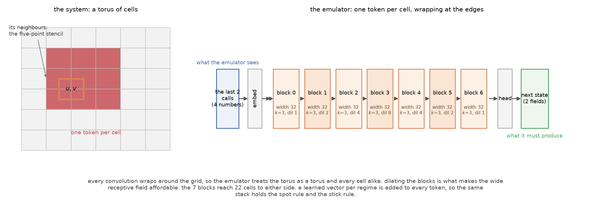

*Figure 2 — the circular-convolution stack and the regime vector added to every token.*

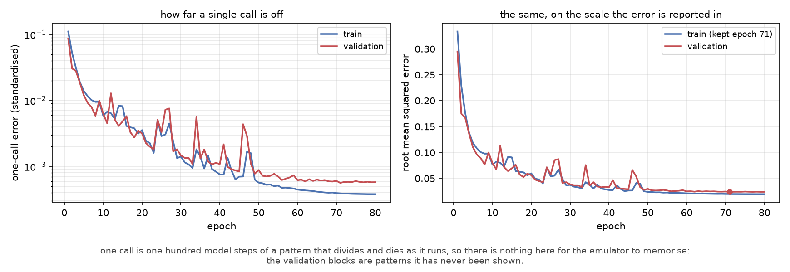

*Figure 3 — one-call training and validation error.*

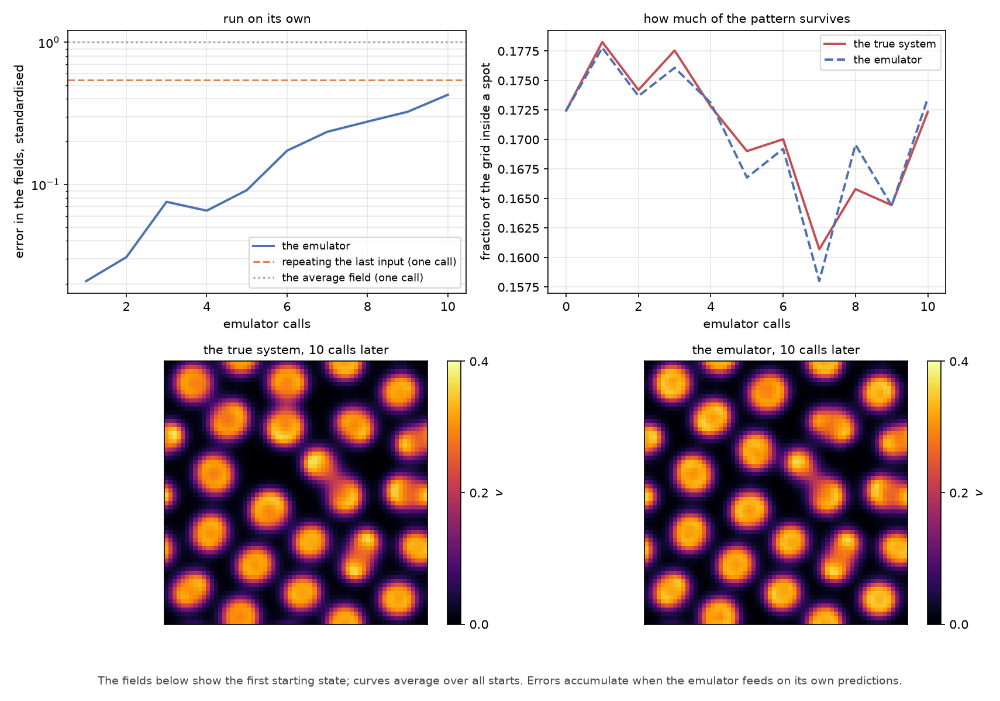

*Figure 4 — the emulator and the true system from the same blob-regime states, run freely.*

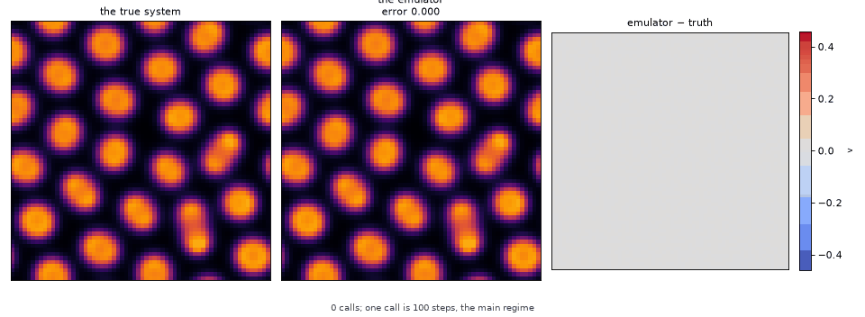

*Animation 4 — the same comparison frame by frame, with the difference `emulator − truth` in the
third panel; the emulator's prediction becomes the next input at every call.*

## 4. Sparse autoencoder

*What to run:*

```bash
../../../.venv/bin/python train_sae.py --data data/gray_scott_mixed.npz --model-dir model \
  --figures figures --layer blocks.6 --n-latent 512 --k 16 --epochs 120 --lr 5e-4 \
  --train-states 300 --val-states 60 --stick-share 0.5 --seed 0 --threads 6
```

The SAE rebuilds the block-6 token (the last residual block) at one cell. It has 512 directions of
32 numbers; the encoder keeps the 16 largest nonnegative scores and zeroes the rest; the decoder
adds the survivors. Training minimises reconstruction error. The grid, equations and next state
are never inputs. Tokens come from 300 training and 60 validation states, half from the blob
regime and half from the stick regime.

The recorded run trained for 120 epochs in 1 063 s at `lr = 5 × 10⁻⁴` and kept epoch 78.
Reconstruction, `1 - MSE / Var(token)`, is **0.989** held out (train 0.989), 0.984 in the blob
regime and 0.992 in the stick regime: 16 of 512 directions rebuild about 99% of the token variance.
The token has low effective dimension: 7 principal components hold 95% of its variance and 18
hold 99%, so the SAE is overcomplete by more than an order of magnitude. 510 of 512 directions
activate at least once (firing rate is the fraction of tokens where a direction is active), 2
never activate, and the median firing rate among active directions is about `7 × 10⁻⁴`.

`interpret.py` fits ridge regressions from the 512 activations, or from the layer's 32 token
numbers, to each named quantity, including elongation. This is a linear readout, not the SAE. It
reports the best single direction, all 512 jointly, and the token's own 32 numbers.

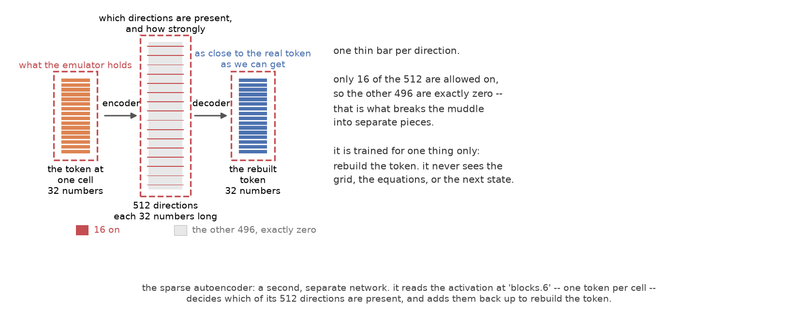

*Figure 5 — one token in, a mostly-off list of directions, the token rebuilt.*

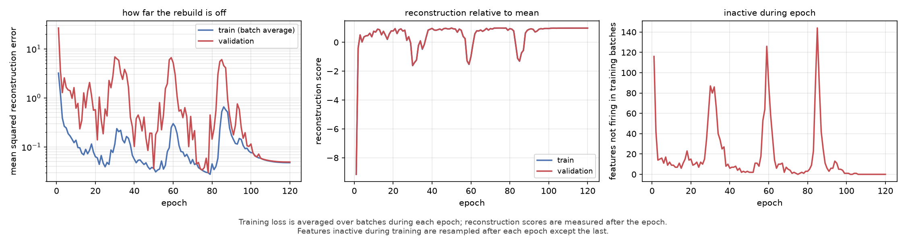
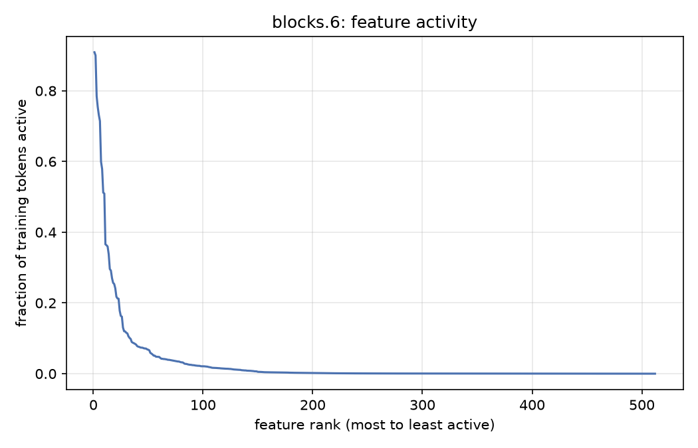

*Figure 6 — top: training curves and inactive directions per epoch; bottom: firing rate by
direction rank.*

## 5. A direction for elongated shape

*What to run:*

```bash
../../../.venv/bin/python component_study.py --data data/gray_scott_mixed.npz --model-dir model \
  --figures figures --permutations 1000 --bootstrap 1000 \
  --probe-layers blocks.4,blocks.5,blocks.6
```

A *feature* is one decoder direction `d_k ∈ R³²` together with its activation `z_k(x)`. We ask
whether its component-mean activation ranks sticks above blobs.

### 5.1 The label: elongation and component shape

As in §1.1, we threshold at `v > 0.25`, split into four-connected components with at least 8
cells, and give each component `E = sqrt(λ₁/λ₂)`. We also measure area, **solidity** (area /
convex-hull area), skeleton length, skeleton width and branch points. We use four classes:

- **stick**: `E ≥ 3` and solidity `≥ 0.7`;
- **blob**: `E ≤ 1.6`, solidity `≥ 0.7`, area 8–200;
- **labyrinth**: solidity `< 0.5` (the long connected network); everything else is *other*.

| split | regime | stick | blob | labyrinth | other |
|---|---|---:|---:|---:|---:|
| validation | blob | 62 | 4 965 | 0 | 481 |
| validation | sticks | 540 | 486 | 0 | 0 |
| test | blob | 83 | 4 871 | 0 | 602 |
| test | sticks | 530 | 477 | 0 | 0 |

The main comparison is within the stick-rich regime. To compare shapes fairly, we match its 540
validation sticks to 486 blobs on size and occupancy. Each component gets two numbers,
`log(area)` and its mean `v` (the average field value inside the component). We standardise both
across the regime's sticks and blobs, then pair each stick, in random order, with the nearest
unused blob in that two-number space. The log makes the area distance relative, so 20 vs 40 cells
counts like 100 vs 200. This makes the two groups similar in size and occupancy, so a direction
that only detects size or mean `v` cannot separate them. Because the regime has 540 sticks but
only 486 blobs, we match every blob, so we cannot fully equalise area: matched sticks remain larger
(78.5 vs 28.3 cells) and slightly less solid (§5.4). A second comparison repeats this in the blob
regime (62 sticks against 62 matched blobs).

### 5.2 Scoring a direction

We need one number per direction to compare 512 candidates. We use AUROC: the probability that a
randomly chosen stick component has a higher mean activation than a randomly chosen blob
component. A score of 0.5 means no information, 1.0 means perfect separation, and 0.0 means it
ranks sticks below blobs; ties count as half. We score connected components rather than cells
because cells inside a component are correlated, so a cell-level score would look more precise
than it is.

Both classes are occupied, so a direction that only detects occupancy scores about 0.5. The match
keeps both classes in the same regime and balances mean `v`, but it does not fully control size
(§5.4).

Three controls make the score interpretable:

- **Search over 512 directions.** We report the best-scoring direction, so its AUROC is
  optimistically biased. We shuffle the labels across matched components 1 000 times and recompute
  the maximum AUROC each time. We compare the observed score with this null; §5.3 gives the 95th
  percentile and the permutation p-value.
- **Finite sample.** We resample components with replacement to get a confidence interval for the
  selected direction's AUROC.
- **Is the label present in the token?** A linear probe is a simple diagnostic readout: a single
  weighted sum of the 32 token numbers plus a bias. We fit its weights by ridge regression (least
  squares with a small penalty). It has no hidden layers and does not use the SAE. We fit two
  probes at `blocks.4`, `blocks.5` and `blocks.6`: one to the binary stick/blob label (scored by
  AUROC) and one to the continuous elongation `E` (scored by R²). A successful probe shows that
  the token already contains the target, so a high SAE score reflects the dictionary rather than
  missing information. A failed probe would make a high SAE score suspicious.

§5.3 reports the scores.

### 5.3 The scores

Each row is one measurement; *validation* is the split used to pick the direction and *test* the
held-out split. The emulator and SAE are trained on the separate training split. Direction 473 is
the control: it has a firing rate close to 159 but no shape signal. *Transfer* applies 159 to the
blob regime without refitting.

| measurement | validation | test |
|---|---:|---:|
| direction **159**, stick vs blob (main comparison, stick regime) | **1.000** | **1.000** |
| permutation null, 95th percentile | 0.555 | — |
| permutation p (max over 512) | 0.001 | — |
| bootstrap 95% CI for 159 | 1.000–1.000 | — |
| direction **74**, blob vs stick (reverse, stick regime) | 1.000 | 1.000 |
| direction 74, stick vs blob (second comparison, blob regime) | 0.998 | 0.961 |
| direction 159 applied to the blob regime (transfer) | — | 0.534 |
| control direction 473 (no shape signal) | 0.500 | 0.500 |
| linear probe, binary, blocks 4/5/6 | — | 1.000 |
| linear probe, continuous R², blocks 4/5/6 | — | 0.981 / 0.983 / 0.983 |

The 512 scores do not cluster around 0.5: direction 159 is far outside the permutation null
(0.555) and is stable from validation to test (1.000). Direction 74 is its reverse — a blob
direction within the same regime. The control direction 473 scores 0.500, so the result depends
on this direction, not just on any active direction. The second comparison is inside the blob
regime (0.998 validation, 0.961 test), but direction 159 itself does **not** transfer to the blob
regime (0.534 test): the shape representation is also regime-specific. The probe from the token
reaches 1.000 for the binary class and R² 0.98 for continuous elongation at all three layers.
The token therefore encodes elongation almost linearly. The SAE direction separates the
**thresholded** stick/blob classes, and its score correlates 0.86 with `E`.

### 5.4 Where the direction activates

| direction | mean on stick components | mean on matched blob components |
|---|---:|---:|
| 159 (stick) | **2.75** | 2.05 |
| 74 (blob) | 0.22 | **0.48** |

Direction 159 has a 1.34× stronger activation on stick than on blob components, and its
component score correlates 0.86 with `E`. The matched sets still differ in size and solidity.
Sticks have `E = 6.00`, area 78.5, solidity 0.920, skeleton length 17.5, width 4.69 and 1.08
branch points.
Blobs have `E = 1.10`, area 28.3, solidity 1.000, skeleton length 1.59, width 19.5 and no branch
points. Direction 159 may therefore also encode area or solidity. Direction 74 is the reverse:
it activates on blobs (0.48) and is nearly silent on sticks (0.22). The control direction 473 has
AUROC 0.500. The bottom row of Figure 7 shows two test states: when each component is coloured
by the feature's mean activation, the sticks are brighter than the blobs.

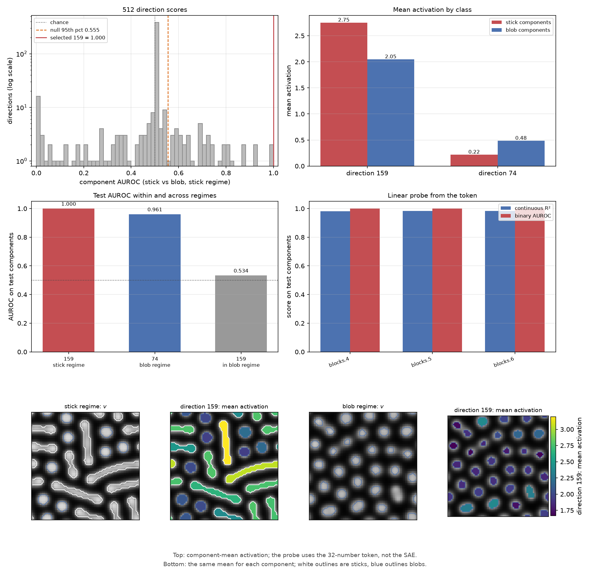

*Figure 7 — top left: scores of the 512 directions; most sit at chance, and direction 159 is far
above the permutation null (95th percentile 0.555). Top right: mean activation of directions 159
and 74 on stick and blob components. Middle left: test AUROC for 159 inside the stick regime, 74
inside the blob regime, and 159 applied to the blob regime; the first two generalise, the third
does not. Middle right: a linear probe from the 32 token numbers to the stick/blob label (binary
AUROC) or to elongation (continuous R²); it does not use the SAE. Bottom row: two test states,
one from each regime, chosen for having many sticks or many blobs. In each pair the first panel
is `v`, with sticks outlined in white and blobs in blue; the second fills every component with
the feature's mean activation over its cells, the quantity the score uses. In the stick regime
the sticks are bright and the blobs dark; in the blob regime every component is dark.*

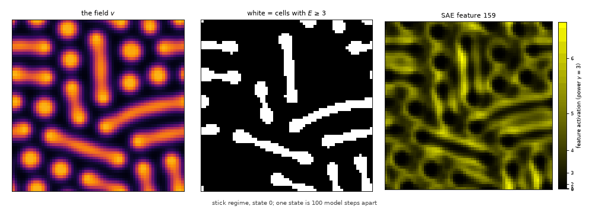

*Animation 5 — direction 159 on a stick trajectory: `v`; a binary mask (white = cells in a
component with `E ≥ 3`); and the direction's activation on a fixed colour scale across frames.
The animation starts at a test state that contains separate sticks; the highest activation
follows the white stick cells.*

## 6. Holding the stick feature on

*What to run:*

```bash
../../../.venv/bin/python push_study.py --data data/gray_scott_mixed.npz --model-dir model \
  --figures figures --pairs 120 --sites 3 --calls 20 --seed 0
```

We hold the stick feature on through the SAE. On a real stick component `C`, the feature's
activation `z(x)` masked by `C`, clipped at zero and normalised so the peak is 1, gives a
footprint `A_0`. The footprint is blurred with a Gaussian of `\sigma = 1.2` cells, so the push
has no sharp edges. We move it to a site and combine three sites by taking the larger
amplitude:

$$A(x) = \max_{s=1,2,3} A_s(x).$$

At every call, a block-6 token `h(x)` goes through the SAE: the latents are `encode(h)`, the
stick latent `k` is increased by `a A(x)`, and the modified latents are decoded:

$$h(x) \leftarrow \mathrm{decode}\left(\mathrm{encode}(h(x)) + a\,A(x)\,e_k\right).$$

We set `a = 4m`, where `m` is the mean token norm of the state. The control runs the same
encode/decode path with `a = 0`, so the only difference is the stick latent. The emulator runs
on its own predictions for 20 calls.

We measure, at every call, within 8 cells of the three sites:

- the share of cells that belong to an elongated component (`E ≥ 3`);
- the number of elongated components.

We also record the same share over the whole grid and the coverage. A strength sweep repeats
the run with `a = 2m` and `a = 6m`.

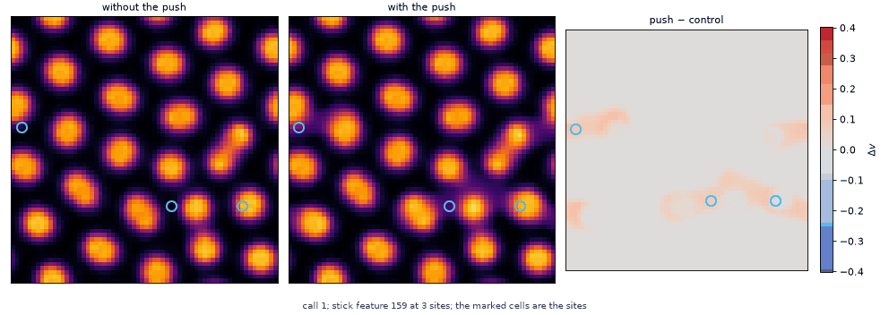

*Animation 6 — the same pair frame by frame: `v` without the push, `v` with the push, and their
difference. The marked cells are the three sites. The push runs through the SAE on every call.
Shown is the strongest of 12 candidate states: the stick share within 8 cells of the sites
reaches 39% with the push and stays at 0% without it.*

## 7. What the measurements say

**Scores.** Direction 159 reaches **1.000** on validation and **1.000** on test within the
stick-rich regime, with permutation p = 0.001, null 95th percentile 0.555, and bootstrap CI
1.000–1.000. Within the blob regime the same direction does not transfer (0.534 test), although
the blob regime has its own blob/stick direction (74, 0.998/0.961). The token-only linear probe
reaches AUROC 1.000 for the binary label and R² 0.98 for elongation at every layer. The dictionary
has a strong shape-class feature; the token also encodes elongation almost linearly.

**Holding the feature on.** We use 120 states; one state is 0.83 percentage points. All
intervals are 95% bootstrap intervals over states. The table gives the last call (20).

| outcome at call 20 | without the push | with the push | difference [95% CI] |
|---|---:|---:|---:|
| share of cells near a site in elongated components | 2.9% | 14.8% | +11.9 pp [10.0, 13.7] |
| elongated components near a site | 0.38 | 2.22 | +1.84 [1.62, 2.05] |
| cells in elongated components, whole grid | 1.5% | 3.0% | +1.6 pp [1.2, 1.9] |
| coverage | 18.1% | 18.8% | +0.6 pp [0.4, 0.9] |

The pushed rollout ends with more elongated components near a site than its control in 88.3%
of states [82.5, 93.3].

The curves separate at call 5: the near-site stick share goes from 3.1% at call 4 to 10.7% at
call 5, peaks at 26.1% at call 8, then declines to 14.8% by call 20. The control drifts from
0.7% to 2.9%. The number of components rises from about 0.1 to 2.2 and keeps rising, so the
drop in share is not a loss of sticks.

The strength sweep shows a threshold. At `a = 2m` the final near-site share is 2.6%, the same
as the control (2.9%); at `a = 4m` it is 14.8%; at `a = 6m` it is 35.6%. A weak push does
nothing; the effect needs between two and four times the token norm.

Because the control passes through the same encode/decode path, the difference is the stick
latent, not the SAE reconstruction. Holding one dictionary direction on is enough to turn
about one near cell in seven into an elongated component at the end of the run, and one in
four at the peak. This is a causal test inside the emulator only; it does not show that the
same push acts on the true system.

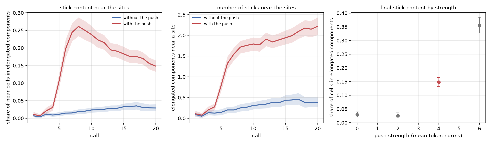

*Figure 8 — left and middle: the two time series over 20 calls, mean and 95% band over 120
states; right: final near-site stick share against push strength. The control is the same SAE
path with `a = 0`.*

**Controls: adding `v` instead of the feature.** We repeat the run at the same sites with the
same footprint, but change the `v` field directly instead of the SAE latent. Each control adds
the same RMS change in `v` at every call as the feature push produces on its first call. A
random smooth pattern and the footprint itself serve as controls; both use the same SAE
round-trip with no added activation.

| condition | share call 8 | share call 20 | mean area call 8 | mean area call 20 |
|---|---:|---:|---:|---:|
| SAE push | 26.1% [23.4, 28.7] | 14.8% [13.2, 16.4] | 80.4 | 36.4 |
| SAE without the push | 1.9% [1.2, 2.5] | 2.9% [2.0, 4.0] | 9.6 | 12.4 |
| `v` in the same footprint | 10.8% [8.7, 13.0] | 23.8% [21.6, 25.9] | 30.1 | 46.0 |
| random `v` | 1.2% [0.7, 1.8] | 21.7% [19.3, 24.2] | 4.9 | 14.9 |

A random `v` addition does not create sticks by call 8; late in the run its share rises, but the
components are small (mean area 14.9, about 40% of the feature's) and the field loses coverage
early (0.12, against 0.19 for the feature). Adding `v` in the stick-shaped footprint is
stronger: 10.8% by call 8 and 23.8% by call 20, with area 30.1 and 46.0. So a stick-shaped
`v` patch also creates sticks, but more slowly and with smaller components early; by call 20 the
field controls catch up in share. The SAE push is not the only route to sticks; its advantage
is speed and coherence. Area is in cells.

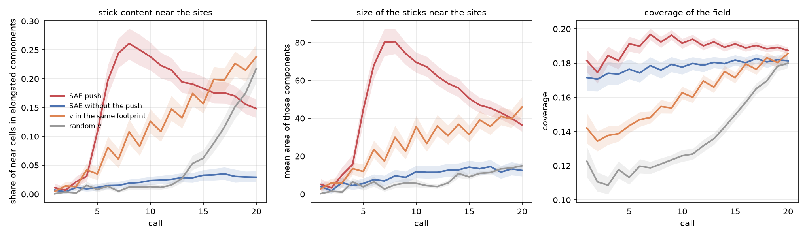

*Figure 9 — controls at the same sites and strength: near-site stick share, mean area of the
near-site elongated components, and coverage over 20 calls. The feature push acts within five
calls and makes large components; the footprint `v` addition acts more slowly; the random `v`
addition fragments the field and makes small components late.*

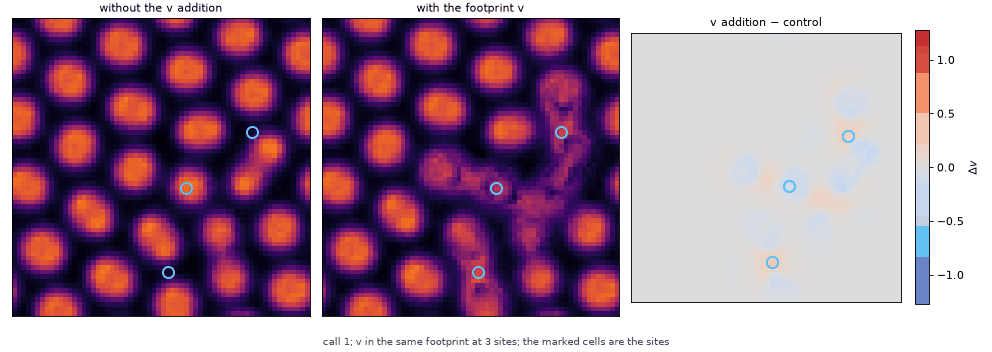

*Animation 7 — the matched `v` control in the same layout as Animation 6: `v` without the
addition, `v` with the footprint added at every call, and their difference. The marked cells
are the three sites. This is the strongest of 12 candidate states: the near-site stick share
reaches 41% with the addition and stays at 0% without it. The sticks appear more slowly than
with the SAE push.*

## 8. Limitations

- **One direction and footprint.** Held-out component AUROC is 1.000 within the stick regime,
  but the push uses one direction (159) on one footprint at three random sites. It is compared
  with the same SAE path at zero added activation, not with other directions, footprints or
  sites. It therefore cannot show that the effect is specific to direction 159.
- **Not unique to the SAE.** A stick-shaped `v` addition at the same sites also creates sticks,
  though later and smaller at call 8; a random `v` addition fragments the field and produces
  many small components late. The feature's advantage is speed and component size, not the
  ability to make sticks at all.
- **Push strength.** At `a = 2m` the effect is indistinguishable from the control; the reported
  run uses `4m`, and `6m` gives a larger final share (36%). The push is moderate, and the field
  stays in the blob regime (coverage 18.1% → 18.8%).
- **Thresholded classes.** The feature separates `E ≥ 3` from `E ≤ 1.6`; the token-only linear
  probe reaches AUROC 1.000 for that binary class and R² 0.98 for continuous `E`. The SAE direction
  itself is still a thresholded class detector, not a calibrated scalar measurement.
- **Component samples.** On validation we compare 486 sticks with 486 matched blobs; on test,
  530 sticks with 477 blobs. The second comparison, in the blob regime, uses 62 validation and 83
  test sticks. Matching is greedy on log area and mean `v`, not exact: with fewer blobs than
  sticks, all blobs are used and the matched sticks stay larger and less solid (§5.4). The AUROC
  alone therefore does not exclude an area or solidity component, and orientation, curvature and
  branching are not matched either.
- **Regimes.** The main comparison is within the stick regime: sticks against blobs. A second
  comparison is within the blob regime: its few sticks against matched blobs. The cross-regime
  comparison is not used for selection, and direction 159 does not transfer to the blob regime
  (0.534 test).
- **SAE capacity.** 99% of token variance rebuilt; 2 directions never activate; the token has only
  7 principal components for 95% of its variance.
- **One blob regime.** The stick perturbation at `F = 0.026` decays by 4 000 steps (§1.3), so
  longer-lived effects cannot be seen.
- **Elongation is global.** Branched, ring-like or folded components can have high `E` without
  being straight sticks; a labyrinth can have low `E` despite looking elongated.
- **No laboratory experiment.** A physical Gray-Scott preparation cannot be given a change to a
  network's activations.

## 9. Methods and files

| file | what it does |
|---|---|
| `generate_data.py` | integrates both regimes, measures elongation/solidity/skeleton, builds the dataset, sweeps the `(F, k)` plane |
| `make_fig1.py` | the regimes, elongation distributions and disc threshold |
| `train_emulator.py` | regime-conditioned circular-convolution emulator, one-call metrics, free rollout |
| `train_sae.py` | TopK SAE on block-6 tokens, sampled 50% blob and 50% sticks |
| `interpret.py` | receptive field and the physical quantities encoded in each token, including elongation |
| `component_study.py` | component descriptors, matched within-regime comparisons, permutation null, bootstrap, linear probes |
| `stick_study.py` | helpers: stick footprints, the SAE-pushed rollout, shape metrics, bootstrap |
| `push_study.py` | holds the stick latent on through the SAE, tracks stick content over 20 calls, strength sweep |
| `control_study.py` | compares the SAE push with matched `v` additions at the same sites |
| `animate.py` | all animations |

We produce the measurements with:

```bash
../../../.venv/bin/python generate_data.py --out data --main-f 0.026 --main-k 0.059 \
  --stick-f 0.036 --stick-k 0.062 --samples 1600 --stick-samples 400
../../../.venv/bin/python generate_data.py --explore --figures figures
../../../.venv/bin/python make_fig1.py --data data/gray_scott_mixed.npz --model-dir model --out figures
../../../.venv/bin/python make_fig1.py --data data/gray_scott_mixed.npz --model-dir model \
  --threshold --main-index 0
../../../.venv/bin/python train_emulator.py --data data/gray_scott_mixed.npz --model-dir model \
  --figures figures --architecture 32-32-32-32-32-32-32 --dilations 1,2,4,8,4,2,1 \
  --epochs 80 --seed 0 --rollout-regime 0 --rollout-calls 10 --threads 6
../../../.venv/bin/python train_sae.py --data data/gray_scott_mixed.npz --model-dir model \
  --figures figures --layer blocks.6 --n-latent 512 --k 16 --epochs 120 --lr 5e-4 \
  --train-states 300 --val-states 60 --stick-share 0.5 --seed 0 --threads 6
../../../.venv/bin/python interpret.py --data data/gray_scott_mixed.npz --model-dir model \
  --figures figures --regime 0 --states 120 --tag main --threads 6
../../../.venv/bin/python interpret.py --data data/gray_scott_mixed.npz --model-dir model \
  --figures figures --regime 1 --states 54 --tag sticks --threads 6
../../../.venv/bin/python component_study.py --data data/gray_scott_mixed.npz --model-dir model \
  --figures figures --permutations 1000 --bootstrap 1000 \
  --probe-layers blocks.4,blocks.5,blocks.6 --threads 6
../../../.venv/bin/python push_study.py --data data/gray_scott_mixed.npz --model-dir model \
  --figures figures --pairs 120 --sites 3 --calls 20 --seed 0
../../../.venv/bin/python control_study.py --data data/gray_scott_mixed.npz --model-dir model \
  --figures figures --pairs 120 --sites 3 --calls 20 --seed 0
../../../.venv/bin/python animate.py --data data/gray_scott_mixed.npz --model-dir model \
  --figures figures --only regimes,stick-perturb,disc,rollout,feature,injection,v-injection --fps 10
```

AUROC is the Mann–Whitney statistic with ties averaged; 0.5 is chance. Component scores average
the activation over each component's cells. The permutation null shuffles labels across matched
components; the bootstrap resamples components. The stick interpretation uses 54 states because
that validation block holds 54 examples.

Artifacts: `data/gray_scott_mixed.npz`; `model/emulator.pt` with `metrics.json` and
`history.json`; `model/sae.pt` with `sae_metrics.json` and `sae_history.json`;
`model/interpret_main.json`, `model/interpret_sticks.json`; `model/stick_components.json`;
`model/stick_push.json`; `model/stick_controls.json`; `model/system.json`,
`model/threshold.json`; figures:
`regimes_two.png`, `regimes_compare.gif`, `stick_perturb.gif`, `disc_threshold.gif`,
`architecture.png`, `training.png`, `skill.png`, `rollout_main.gif`, `sae.png`,
`sae_training.png`, `sae_firing_rates.png`, `receptive_field_main.png`,
`receptive_field_sticks.png`, `features_main.png`, `features_sticks.png`,
`stick_components.png`, `stick_feature.gif`, `injection.gif`, `stick_push.png`,
`stick_controls.png`, `v_injection.gif`. Environment: NumPy, PyTorch, Matplotlib
(`requirements.txt`), CPU.

In the JSON artifacts the blob class uses the key `round`; the text and figures call it blob. The
JSON also names the validation and test splits `discovery` and `evaluation`; the text calls them
validation and test.
